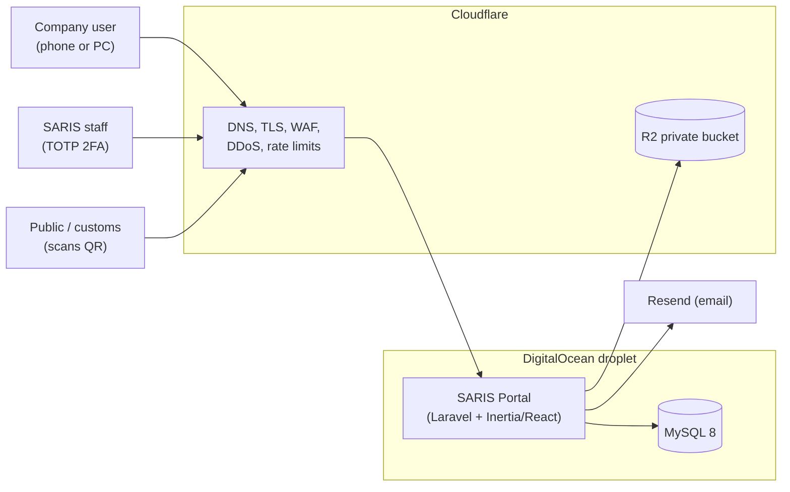
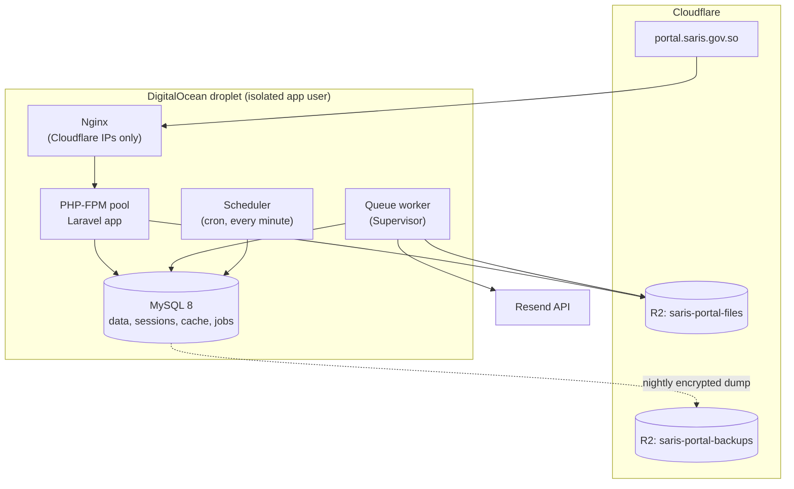
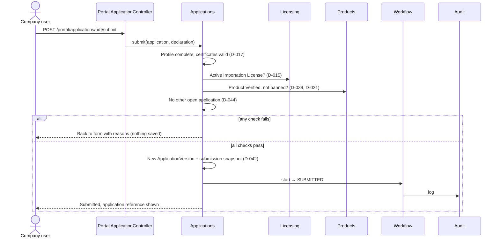

# Deliverable 1 — System Architecture (v2, based on the existing codebase)

- Project: SARIS Company Portal
- Version: 2.1 (approved; replaces the v1 draft, which assumed no existing code)
- Date: 2026-10-28
- Based on: `docs/decisions-log.md` (D-001 to D-046), `docs/requirements-answers.md`,
  `docs/design/00-current-state.md` (commit `009f947`)

---

## 1. Summary

The SARIS portal is built **on the existing Laravel application** in the repository
root. Nothing is rebuilt from scratch. The existing stack is kept:

| Layer | Existing (kept) |
|---|---|
| Backend | PHP 8.2+, Laravel 12 |
| UI | Inertia 2 + React 19 + TypeScript, Tailwind 4, shadcn/ui |
| Auth (both portals) | Fortify (login, reset, TOTP 2FA) |
| Roles | spatie/laravel-permission |
| Email | resend/resend-laravel |
| Tests | Pest |

The application stays **one deployable Laravel app** (a modular monolith) with three
areas:

| Area | Users | URL prefix |
|---|---|---|
| **Admin Portal** | SARIS staff (D-023) | `/admin/*` |
| **Company Portal** | Company account holders (D-001) | `/portal/*` plus company auth pages |
| **Public pages** | Anyone | `/verify/{code}`, `/account-recovery` |

**Main change from v1:** there is no separate JSON API. Inertia serves both portals
through server routes, which is simpler for a small team and already in place. The
separation required by D-036 is achieved with separate user tables, guards, route
groups, middleware and session cookies (section 4).

---

## 2. System Context



External services in Phase 1: Cloudflare (edge protection, R2 storage) and Resend
(email) only (D-030).

---

## 3. Deployment



| Component | Role |
|---|---|
| Nginx | Web server; accepts traffic only from Cloudflare IP ranges |
| PHP-FPM + Laravel | All pages for both portals and the public pages |
| Queue worker | PDF generation, emails, image processing |
| Scheduler | Expiry and reminder jobs (section 8) |
| MySQL 8 | All data; also the session, cache and queue store (the existing `database` drivers) |
| Cloudflare R2 | Uploaded files and generated PDFs (D-040); separate bucket for backups |
| Resend | Outgoing email from a saris.gov.so address |

**No Redis in Phase 1.** The existing database drivers for sessions, cache and queues
are enough for fewer than 500 companies and leave one less service to maintain.

**Isolation on the existing droplet (H3):** own Linux user, own PHP-FPM pool, own MySQL
database and user. **Environments:** production and staging.

---

## 4. Portal Separation (how D-036 is met with Inertia)

| Layer | Admin Portal (staff) | Company Portal |
|---|---|---|
| User table and model | `users` / `App\Models\User` (existing; staff only) | **New** `company_users` / `App\Models\CompanyUser` |
| Auth guard | `web` (existing, Fortify) | **New** `company` guard, own password broker |
| Login and auth pages | Fortify under `/admin` (`/admin/login`, …) | Fortify (`/login`, `/forgot-password`, 2FA) plus a small `/signup` form (D-062, D-063) |
| Route file | `routes/admin.php` | `routes/portal.php` |
| URL prefix | `/admin/*` | `/portal/*` |
| Middleware group | `auth:web`, `active`, `2fa.enforced`, `permission:*` | `auth:company`, `password.changed`, `company.scope` |
| Session cookie | `saris_admin_session` | `saris_portal_session` |
| Roles and permissions | spatie roles (D-023) | None (D-001: one account, full rights) |
| 2FA | Mandatory TOTP (D-052) | Optional TOTP (D-064) |
| Frontend pages and layout | `resources/js/pages/admin/*`, `AdminLayout` | `resources/js/pages/portal/*`, `PortalLayout` |

Rules:

1. A staff user cannot log in to the Company Portal and a company user cannot log in to
   the Admin Portal; they are in different tables with different guards.
2. Each area sets its own session cookie name before the session starts, so the two
   sessions are fully independent in the same browser.
3. Every company query is scoped to the logged-in user's `company_id`. Changing an ID
   in the URL can never expose another company's data.
4. Every admin action checks the staff member's permission for the current workflow
   stage (D-023), not only that the user is staff.
5. Admin and company controllers live in separate namespaces; none serves both.
6. Inertia page components are loaded lazily per page, so company users never download
   admin pages.

Automated tests must prove rules 1 to 4.

---

## 5. Modules and Code Organisation

Laravel's standard layout is kept (models in `app/Models`). Business logic is grouped by
module under `app/Domain/`, and controllers are split by area.

```
app/
├── Domain/
│   ├── Identity/          Fortify per-area setup, sign-up, account recovery, staff 2FA enforcement
│   ├── CompanyRegistry/   Company, Person, Premises, FacilityChecklistItem, Document
│   ├── Products/          My Products, verification, banned/restricted check
│   ├── Applications/      Drafts, validation per service, submission, versions, snapshots
│   ├── Workflow/          Templates, stages, transitions, review checklists, returns
│   ├── Inspection/        Scheduling, inspection report, media
│   ├── Payments/          Fee schedule, permission-to-pay letter, receipt, clearance
│   ├── Licensing/         Numbering, LicenseSnapshot, register, lifecycle
│   ├── Documents/         PDF templates, QR codes, R2 storage
│   ├── Notifications/     Bilingual emails via Resend
│   ├── Audit/             Activity log
│   └── ReferenceData/     Regions, means of entry, restricted list, fee schedule
├── Http/Controllers/
│   ├── Admin/             Staff controllers (existing User/Role controllers move here)
│   ├── Portal/            Company controllers
│   └── Public/            Verification, account recovery
└── Models/                All Eloquent models
```

| Module | Main entities | Company | Admin |
|---|---|---|---|
| Identity | User (staff), CompanyUser, AccountRecoveryRequest, Delegation | ✓ | ✓ |
| CompanyRegistry | Company, Person, Premises, FacilityChecklistItem, Document, Address | Write | Read |
| Products | Product, ProductDocument, RestrictedIngredient | Write | Verify |
| Applications | Application, ApplicationVersion | Write | Read |
| Workflow | WorkflowTemplate, WorkflowStage, WorkflowTransition, ReviewChecklist | Read (simplified status) | Act |
| Inspection | InspectionReport | Read (date only) | Write |
| Payments | FeeSchedule, PermissionToPayLetter, Payment | Upload receipt | Issue / clear |
| Licensing | License, LicenseSnapshot, NumberSequence | Read | Act |
| Documents | DocumentTemplate, StoredFile | — | — |
| Notifications | NotificationLog | — | — |
| Audit | Activity log | — | Read |
| ReferenceData | Region, MeansOfEntry, RestrictedIngredient, FeeSchedule | Read | Manage |

---

## 6. Changes to the Existing Codebase

This table maps each conflict and gap in `00-current-state.md` §9 to an action.

| # | Item | Action |
|---|---|---|
| 1 | Single `users` table for everyone (D-036) | Keep `users` for **staff only**; add `company_users` and the `company` guard (section 4) |
| 2 | One login page, optional 2FA (D-031, D-037) | Move Fortify under `/admin`; add middleware that forces staff to set up and use TOTP before any admin page |
| 3 | Passport installed, no API in use | **Remove Passport** (tables, routes, `HasApiTokens`). No API in Phase 1; less attack surface |
| 4 | Jetstream installed, live unused routes, missing Sanctum | **Remove Jetstream** and its routes (`user/profile`, `DELETE user`, etc.) |
| 5 | Hard deletes (D-034) | Add soft deletes to all models; staff users are **deactivated** (status), never deleted; remove self-delete of accounts |
| 6 | `Super Admin` with `Gate::before` bypass (D-023) | Replace with a **System Administrator** role limited to staff users, roles and reference data. Remove the `Gate::before` bypass, so no one can act in the workflow without the stage role |
| 7 | Only Super Admin seeded | Seed the D-023 roles and their permissions |
| 8 | Status is a free string | Status enum for staff (`active`, `inactive`); `suspend user` permission wired to deactivation |
| 9 | `first_login` not set on staff creation; admin-created passwords `min:8` | Set `first_login = true` on creation; apply the strong password policy everywhere |
| 10 | No company sign-up / OTP (sign-up flow) | Sign-up form emails a 1-hour temporary password; login through Fortify; existing ForcePasswordChange forces a new password (D-063) |
| 11 | No account recovery (D-003) | Public `/account-recovery` form and admin review screen |
| 12 | No lockout, no audit log | Account lockout after repeated failures; audit with `spatie/laravel-activitylog` |
| 13 | No i18n (D-032) | `lang/en.json` and `lang/so.json`, shared to React through Inertia; a small `t()` helper |
| 14 | Local disk; `storage/{path}` route (D-040) | R2 disk using Laravel's S3 driver; disable local file serving; client-side image compression |
| 15 | Mail default `log`, placeholder address (D-030) | Resend as default mailer in production; `RESEND_API_KEY` and saris.gov.so address in `.env.example` |
| 16 | SQLite default; test DB `fertitrack_testing` | MySQL 8 in all environments; rename test DB to `saris_portal_testing` |
| 17 | `.rnd` file committed | Remove and add to `.gitignore` |
| 18 | No CI, Docker or deployment files | GitHub Actions (tests, Pint, ESLint) and deployment scripts — Deliverable 9 |
| 19 | Docs in `saris-portal/`, app at root, two CLAUDE.md files | Move `saris-portal/docs/` to `docs/` at the root; merge both CLAUDE.md files into the root one; remove `saris-portal/` |

---

## 7. Key Flows

### 7.1 Import Permit submission (backend rule enforcement)



The license check runs again at `DG_DECISION`.

### 7.2 Files (D-040)

1. The browser compresses images before upload.
2. The backend checks type (PDF, JPG, PNG), size (5 MB) and ownership, then stores the
   file in R2 under a new random key.
3. Files are never overwritten; a replacement is a new file. Snapshots stay valid forever.
4. Downloads: the backend checks permission and redirects to a 5-minute signed R2 URL.

### 7.3 License issue (D-029)

DG approval queues a job that generates the number, LicenseSnapshot, QR code and PDF.
The Records Officer checks and issues it; the license becomes Active and the company is
emailed.

---

## 8. Background Jobs

| Job | When | What it does |
|---|---|---|
| License expiry | Daily | Active → Expired at expiry date (D-009) |
| Import Permit expiry | Daily | Expired after 90 days (D-021) |
| Renewal reminders | Daily | Emails at 60 and 30 days before expiry |
| Certificate reminders | Daily | Emails 30 days before Ministry certificate expiry (D-017) |
| OTP and token cleanup | Hourly | Remove expired OTPs and reset tokens |
| Database backup | Nightly | Encrypted dump to the R2 backup bucket |
| PDFs and emails | Queue | Generated outside the web request |

---

## 9. Cross-Cutting

| Topic | Approach |
|---|---|
| Security | OWASP defaults, Cloudflare WAF, rate limits, lockout, CSRF (built into Laravel/Inertia), strong passwords, mandatory staff 2FA, encrypted sensitive fields. Detail in Deliverable 3. |
| Audit | Every login, submission, workflow action, payment action, product verification, role or user change is logged (actor, time, IP, before/after). |
| Languages | Somali and English UI, user can switch; data in English; bilingual emails and certificates (D-032). |
| Low bandwidth | Mobile-first React pages, lazy-loaded pages, image compression, paginated lists, autosaved drafts (D-046). |
| Configuration | Workflow templates, fees, reference lists, document templates and the restricted list are data managed in the Admin Portal (D-041). |
| Scale | One droplet for < 500 companies; resize or move to a managed database later without code changes. |

---

## 10. Repository Layout (after item 19)

```
pestcontrolsystem/            ← repository root = the Laravel app
├── CLAUDE.md                 ← merged guidance (base app + SARIS rules)
├── docs/
│   ├── decisions-log.md
│   ├── requirements-answers.md
│   ├── design/               ← 00-current-state.md, 01-architecture.md, …
│   └── forms/                ← applications/, templates/
├── app/Domain/…              ← modules (section 5)
├── app/Http/Controllers/{Admin,Portal,Public}
├── routes/{admin,portal,public,settings}.php
├── resources/js/pages/{admin,portal,public}
├── lang/{en,so}.json
└── tests/
```

---

## Open questions

1. Droplet details: size, OS and PHP version, and which other sites run on it.
2. Final domain: is `portal.saris.gov.so` acceptable?
3. Staging location: a staging subdomain on the same droplet (recommended) or a small
   second droplet?

## Assumptions made

- [ASSUMPTION] Domain `portal.saris.gov.so`.
- [ASSUMPTION] No external system needs an API in Phase 1.

## Decisions (all confirmed 2026-10-28)

| Decision | Summary |
|---|---|
| D-047 | Build on the existing app: Laravel 12, Inertia 2, React 19 + TypeScript, Tailwind 4 + shadcn/ui, Fortify, spatie/laravel-permission, Resend. One modular monolith; no separate JSON API in Phase 1. |
| D-048 | Portal separation as in section 4: `users` = staff (Fortify, `/admin`), new `company_users` + `company` guard (Fortify, D-062), separate route files, middleware and session cookies. **Supersedes the API part of D-036** (`/api/portal/*`, `/api/admin/*`, token audiences); its intent is unchanged. |
| D-049 | Remove Passport and Jetstream. |
| D-050 | MySQL 8 in all environments; database drivers for session, cache and queue; no Redis in Phase 1. |
| D-051 | System Administrator role (staff users, roles, reference data only) replaces the Super Admin bypass; `Gate::before` removed. |
| D-052 | Staff 2FA (TOTP) enforced by middleware before any admin page. |
| D-053 | Soft deletes on all models; staff users are deactivated, never deleted; account self-delete removed. |
| D-054 | i18n with `lang/en.json` and `lang/so.json` shared to React through Inertia. |
| D-055 | Audit logging with `spatie/laravel-activitylog`. |
| D-056 | R2 via the S3 driver, private bucket, 5-minute signed download URLs, local file serving disabled. |
| D-057 | Isolated deployment on the existing droplet; production and staging environments. |
| D-058 | Queue worker (Supervisor) and scheduler (cron) for background jobs. |
| D-059 | Nightly encrypted database backup to a separate R2 bucket. |
| D-060 | Move `saris-portal/docs/` to `docs/` at the root, merge the CLAUDE.md files, remove `saris-portal/`. |
| D-061 | Code organisation: business logic in `app/Domain/<Module>`, controllers in `Admin/`, `Portal/`, `Public/`. |
| D-062 | Fortify handles login, reset and 2FA for both portals; a middleware sets the guard and password broker per area. |
| D-063 | Company sign-up emails a temporary password valid 1 hour; forced password change on first login. |
| D-064 | Optional TOTP 2FA for companies; staff reset it after an approved recovery request. |
