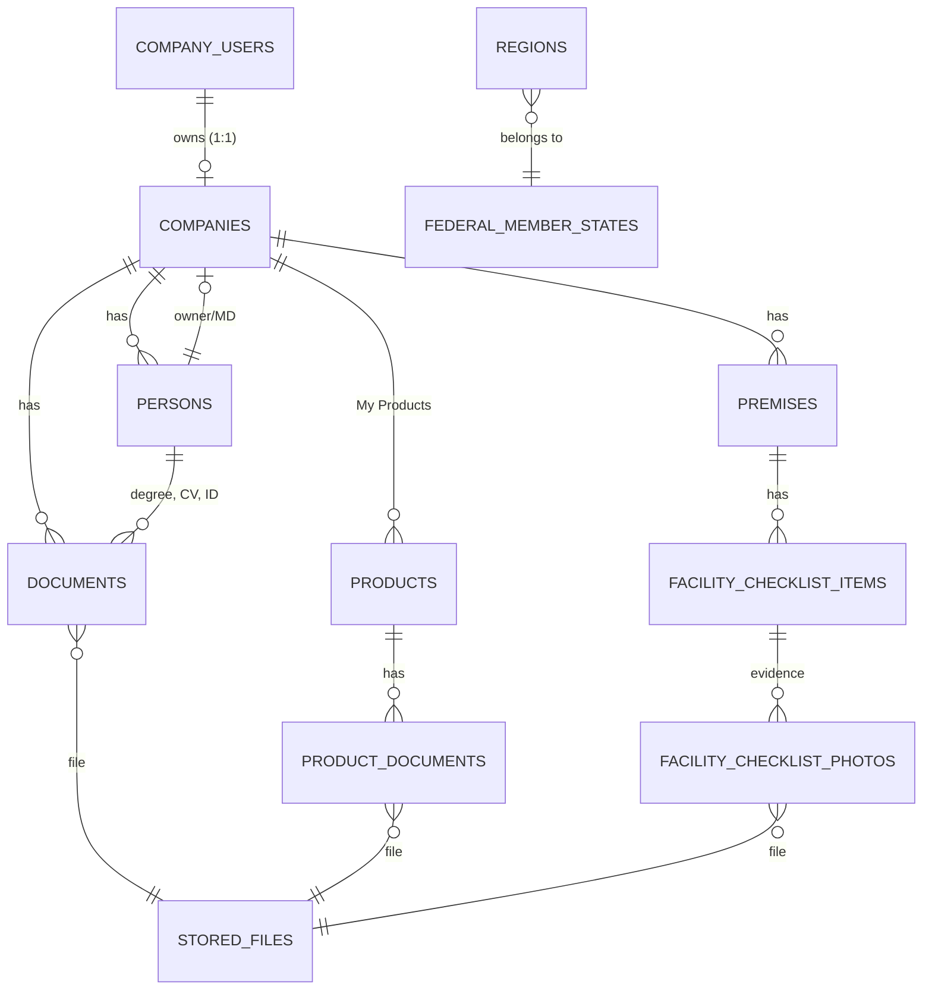
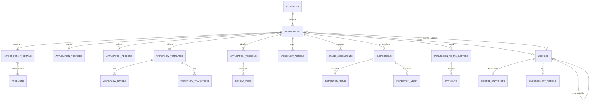
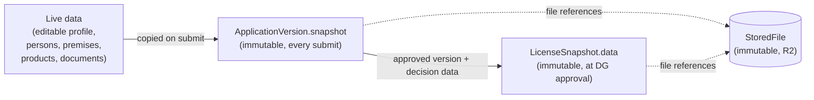

# Deliverable 2 — Data Model

- Project: SARIS Company Portal
- Version: 1.1 (approved 2026-10-28)
- Date: 2026-10-28
- Based on: `docs/decisions-log.md` (D-001 to D-064), `docs/requirements-answers.md`,
  `docs/design/01-architecture.md` (v2.1), `docs/design/00-current-state.md`

---

## 1. Conventions

| Topic | Rule |
|---|---|
| Database | MySQL 8, InnoDB, `utf8mb4` (D-050) |
| Primary keys | `id` BIGINT unsigned auto-increment (Laravel default) |
| Public identifiers | Never expose bare IDs publicly. Applications use `reference`, licenses use `license_number`, QR uses a random `verification_code` |
| Timestamps | `created_at`, `updated_at` on every table, stored in UTC; displayed in Africa/Mogadishu |
| Deletion | `deleted_at` (soft delete) on every business table (D-034, D-053). Immutable tables (versions, snapshots, history, files) are never updated or deleted |
| Enums | PHP backed enums, stored as `string`. Values in `UPPER_SNAKE_CASE` for statuses and codes |
| Money | `decimal(12,2)` plus `currency` `char(3)`; all fees in USD (D-078) |
| Files | Never stored in business tables. Every file is a `stored_files` row (R2 object); tables reference `stored_file_id` (D-056) |
| Normalisation on save | Email lowercase and trimmed; phone in international format (`+252…`); registration, tax and ID numbers trimmed and uppercased |
| Audit | All create/update/delete events are written by `spatie/laravel-activitylog` (D-055), in addition to the domain history tables below |

Type notation used below: `bigint`, `string(n)`, `text`, `bool`, `int`, `date`,
`datetime`, `decimal`, `json`, `enum` (stored as string), `FK→table`.

---

## 2. Entity Overview

| Module | Entity (table) | Purpose |
|---|---|---|
| Identity | User (`users`) | Staff accounts (existing table) |
| Identity | CompanyUser (`company_users`) | The one account per company (D-001) |
| Identity | AccountRecoveryRequest | Public request when email access is lost (D-003, D-064) |
| Identity | Delegation | DG delegation for a date range (D-027) |
| Identity | Role, Permission (spatie tables) | Staff roles (D-023, D-051) |
| ReferenceData | FederalMemberState, Region | Address lists (B9) |
| ReferenceData | RestrictedIngredient | Banned / restricted active ingredients (D-021) |
| ReferenceData | FeeSchedule | Fees per service, category and type (D-038) |
| ReferenceData | NumberSequence | Yearly counters for all numbers (D-011) |
| Documents | StoredFile | One uploaded or generated file in R2 |
| CompanyRegistry | Company | The company profile |
| CompanyRegistry | Person | Owner/MD and technical persons |
| CompanyRegistry | Premises | Warehouses, shops, stores (D-018) |
| CompanyRegistry | FacilityChecklistItem, FacilityChecklistPhoto | Safety items with mandatory photos (B7) |
| CompanyRegistry | Document | Typed company/person documents with expiry (D-017) |
| Products | Product, ProductDocument | My Products, verified once (D-039) |
| Applications | Application | One application for one service (and category) |
| Applications | ApplicationVersion | Immutable submission snapshot per submit (D-042) |
| Applications | ApplicationPremises, ApplicationPerson | Selected premises and technical person |
| Applications | ImportPermitDetail | Consignment data for an Import Permit |
| Workflow | WorkflowTemplate, WorkflowStage, WorkflowTransition | Configurable workflow (D-041) |
| Workflow | WorkflowAction | Immutable history of every transition |
| Workflow | ReviewItem | Compliant / Deficient / Clarification checklist (procedure 6.3, 6.4, 6.8) |
| Workflow | StageAssignment | Technical Reviewer assignment (6.4) |
| Inspection | Inspection, InspectionItem, InspectionMedia | Inspection and signed report (6.5–6.7) |
| Payments | PermissionToPayLetter, Payment | Letter, receipt upload, clearance (D-028) |
| Licensing | License, LicenseSnapshot | Issued licenses and permits (D-006) |
| Licensing | EnforcementAction | Suspend / reinstate / cancel (D-010) |
| Notifications | NotificationLog | Every email sent |
| Audit | activity_log (spatie) | Generic audit trail |

---

## 3. Entity-Relationship Diagrams

### 3.1 Company side



### 3.2 Application, workflow and licensing side



---

## 4. Entity Definitions

Access columns: **C** = Company Portal, **A** = Admin Portal, **P** = public.
R = read, W = write, — = no access.

### 4.1 Identity

#### User (`users`) — existing table, staff only (D-048)

| Field | Type | Notes |
|---|---|---|
| name | string(150) | |
| email | string(190), unique | Login |
| phone | string(30), null | |
| status | enum `ACTIVE`, `INACTIVE` | Replaces free string (D-053) |
| first_login | bool | Set `true` on creation; forces password change |
| password | string | Hashed |
| two_factor_secret, two_factor_recovery_codes, two_factor_confirmed_at | text / datetime | Fortify; mandatory for staff (D-052) |
| failed_login_attempts | int, default 0 | Lockout (Deliverable 3) |
| locked_until | datetime, null | |
| last_login_at | datetime, null | |
| email_verified_at, remember_token, deleted_at | | |

Relationships: roles (spatie), delegations, workflow actions, assignments.
Access: C —, A R/W (System Administrator).

#### CompanyUser (`company_users`) — new (D-001, D-048, D-062, D-063)

| Field | Type | Notes |
|---|---|---|
| company_id | FK→companies, null, **unique** | Null until the profile is created; 1:1 |
| full_name | string(150) | From sign-up |
| email | string(190), unique | Login; reassigned only by account recovery |
| phone | string(30) | From sign-up |
| password | string | Temporary password at sign-up |
| temp_password_expires_at | datetime, null | 1 hour after sign-up or re-send (D-063) |
| first_login | bool, default true | Same flag the existing ForcePasswordChange middleware uses |
| email_verified_at | datetime, null | Set on first successful login with the temporary password |
| two_factor_secret, two_factor_recovery_codes, two_factor_confirmed_at | | Optional (D-064) |
| status | enum `ACTIVE`, `INACTIVE` | |
| failed_login_attempts, locked_until, last_login_at | | Lockout |
| preferred_locale | enum `en`, `so` | UI language (D-032) |
| terms_accepted_at | datetime | Data-protection consent at sign-up (H5) |
| deleted_at | | |

Access: C R/W (own row, limited fields), A R (and W only via account recovery).

#### AccountRecoveryRequest (`account_recovery_requests`)

| Field | Type | Notes |
|---|---|---|
| reference | string(30), unique | Given to the requester |
| company_name | string(200) | As typed by requester |
| business_registration_no | string(60) | Used by staff to find the company |
| contact_name, contact_phone | string | |
| new_email | string(190) | Email to assign |
| letter_file_id | FK→stored_files | Letter signed by Owner/MD |
| md_id_file_id | FK→stored_files | Copy of MD's ID |
| status | enum `PENDING`, `APPROVED`, `REJECTED` | |
| company_id | FK→companies, null | Matched by staff |
| reset_two_factor | bool | Staff choice (D-064) |
| reviewed_by | FK→users, null | |
| reviewed_at | datetime, null | |
| decision_reason | text, null | Mandatory on rejection |
| submitted_ip | string(45) | |

Access: P W (create only), A R/W.

#### Delegation (`delegations`) — D-027

| Field | Type | Notes |
|---|---|---|
| delegator_id | FK→users | The DG |
| delegate_id | FK→users | Signatory |
| starts_on, ends_on | date | Inclusive range |
| reason | string(255) | |
| created_by | FK→users | |
| revoked_at, revoked_by | datetime, FK→users, null | Early end |

Access: A R/W (DG only).

### 4.2 Reference data

#### FederalMemberState (`federal_member_states`) and Region (`regions`)

| Table | Fields |
|---|---|
| federal_member_states | code string(20) unique, name_en, name_so, sort_order, is_active |
| regions | federal_member_state_id FK, name_en, name_so, sort_order, is_active |

The list content is supplied by SARIS (open question 6). Access: C R, A R/W.

#### RestrictedIngredient (`restricted_ingredients`) — D-021

| Field | Type | Notes |
|---|---|---|
| name | string(150), unique | Active ingredient common name |
| cas_number | string(20), null | Optional identifier for matching |
| level | enum `BANNED`, `RESTRICTED` | Banned blocks; restricted flags |
| legal_reference | string(255), null | |
| effective_from | date | |
| is_active | bool | |

Matching is case-insensitive on name (and CAS number when present). Access: C —, A R/W.

#### FeeSchedule (`fee_schedules`) — D-038

| Field | Type | Notes |
|---|---|---|
| service | enum `COMPANY_LICENSE`, `OPERATOR_LICENSE`, `IMPORT_PERMIT` | |
| license_category | enum `IMPORTER`, `WHOLESALER`, `RETAILER`, null | Company License only |
| application_type | enum `NEW`, `RENEWAL`, `AMENDMENT` | Amendment = full fee (D-008) |
| amount | decimal(12,2) | Amounts pending (F1) |
| currency | char(3) | `USD` (D-078) |
| effective_from, effective_to | date, date null | Fee changes never alter past letters |
| created_by | FK→users | |

Access: C —, A R/W (System Administrator).

#### NumberSequence (`number_sequences`)

| Field | Type | Notes |
|---|---|---|
| prefix | string(10) | `PCPIL`, `PCPWS`, `PCPRT`, `PCA`, `PCPIP`, application and letter prefixes |
| year | smallint | Resets yearly (D-011) |
| last_number | int | Incremented inside a locked transaction (`SELECT … FOR UPDATE`) |

Unique (prefix, year). Access: system only.

### 4.3 Documents

#### StoredFile (`stored_files`) — immutable

| Field | Type | Notes |
|---|---|---|
| disk | string(20) | `r2` |
| path | string(255), unique | Random key; never reused or overwritten |
| original_name | string(255) | |
| mime_type | string(100) | PDF, JPG, PNG for companies (D-017) |
| size_bytes | bigint | |
| sha256 | char(64) | Integrity check |
| uploaded_by_type, uploaded_by_id | morph | CompanyUser, User or system |
| purpose | string(50) | e.g. `COMPANY_DOCUMENT`, `FACILITY_PHOTO`, `RECEIPT`, `LICENSE_PDF` |
| created_at | datetime | No `updated_at` changes after insert |

Access through the owning record's permissions only; downloads via 5-minute signed URL (D-056).

### 4.4 Company registry

#### Company (`companies`)

| Field | Type | Notes |
|---|---|---|
| name | string(200) | |
| business_registration_no | string(60), **unique** | Ministry of Commerce number; dedup key |
| tax_compliance_no | string(60) | Ministry of Finance number |
| email | string(190) | Company email (may differ from account email) |
| phone | string(30) | |
| address_* | see §4.9 Address | Company physical location |
| owner_person_id | FK→persons, null | Owner/Managing Director |
| profile_completed_at | datetime, null | Required before any submission |
| amendment_required_at | datetime, null | Set when SARIS releases one of the company's persons (D-066); cleared when an amended license is issued |
| deleted_at | | |

Relationships: one CompanyUser, many persons, premises, documents, products, applications, licenses.
Access: C R/W (own), A R.

#### Person (`persons`) — owned by one company (§6.2)

| Field | Type | Notes |
|---|---|---|
| company_id | FK→companies | Owner company |
| full_name | string(150) | |
| nationality | char(2) | ISO country code; printed on certificate when Owner/MD (D-013) |
| national_id_no | string(60) | Normalised; **unique across the whole system** while not released (D-066) |
| email, phone | string | |
| address_* | §4.9 | Required for Owner/MD |
| qualification | string(200), null | Technical persons (minimum BSc) |
| institution | string(200), null | University / institution |
| years_of_experience | tinyint, null | |
| training_pcp_handling | text, null | Form 1 and 2 |
| training_fumigation | text, null | Form 2 only |
| released_at | datetime, null | Set when SARIS staff release the ID to another company (D-066) |
| released_by | FK→users, null | |
| release_reason | text, null | Mandatory on release |
| active_nid_key | string(60), generated, **unique** | Equals `national_id_no` while `released_at` and `deleted_at` are null, otherwise `NULL`; enforces D-066 in the database |
| deleted_at | | |

A person becomes the Owner/MD through `companies.owner_person_id`, and a technical person
through `application_persons`. One person can be both.
Access: C R/W (own company), A R.

#### Premises (`premises`)

| Field | Type | Notes |
|---|---|---|
| company_id | FK→companies | |
| label | string(100) | e.g. "Main warehouse, Hodan" |
| premises_type | enum `WAREHOUSE`, `SHOP`, `STORE`, `OFFICE` | |
| address_* | §4.9 | |
| gps_lat, gps_lng | decimal(10,7), null | Optional for company; confirmed by Inspector |
| waste_disposal_method | string(255), null | Form 3 §4 |
| deleted_at | | |

Access: C R/W, A R.

#### FacilityChecklistItem (`facility_checklist_items`) and FacilityChecklistPhoto

| Table | Field | Type | Notes |
|---|---|---|---|
| facility_checklist_items | premises_id | FK→premises | |
| | item_code | enum (below) | Unique per premises |
| | is_available | bool | Company declaration |
| | notes | text, null | |
| facility_checklist_photos | facility_checklist_item_id | FK | |
| | stored_file_id | FK→stored_files | Compressed image |
| | captured_at | datetime, null | From the photo when available |

`item_code` values: `VENTILATION`, `FIRE_EXTINGUISHERS`, `PPE`, `SPILL_MANAGEMENT`,
`WASTE_DISPOSAL`, `FIRST_AID_EMERGENCY_PLAN` (Forms 1 and 2), and `FUMIGATION_SHEETS`,
`SAND_SNAKES`, `EQUIPMENT_INVENTORY` (Form 2 only).

Rule: for each premises selected in an application, every item required by that service
must be `is_available = true` and have at least one photo (D-018). Replacing a photo adds
a new row; old rows are soft-deleted. Access: C R/W, A R.

#### Document (`documents`) — typed, with replacement history

| Field | Type | Notes |
|---|---|---|
| company_id | FK→companies | |
| person_id | FK→persons, null | For ID, degree and CV |
| document_type | enum (below) | |
| stored_file_id | FK→stored_files | |
| document_number | string(60), null | e.g. certificate number |
| issued_on | date, null | |
| expires_on | date, null | Required for commerce and tax certificates (D-017) |
| replaced_by_id | FK→documents, null | Set when a newer document of the same type replaces it |
| deleted_at | | |

`document_type` values: `COMMERCE_REGISTRATION_CERTIFICATE`, `TAX_COMPLIANCE_CERTIFICATE`,
`MD_NATIONAL_ID`, `COMPANY_PROFILE`, `DEGREE_CERTIFICATE`, `CV`, `EQUIPMENT_INVENTORY`.

The **current** document of a type is the one with `replaced_by_id IS NULL`.
Access: C R/W, A R.

### 4.5 Products (D-039)

#### Product (`products`)

| Field | Type | Notes |
|---|---|---|
| company_id | FK→companies | |
| trade_name | string(200) | |
| active_ingredient | string(200) | Common name; checked against RestrictedIngredient on save |
| concentration | string(100) | As on label, e.g. "48% a.i." |
| formulation_type | string(50) | e.g. EC, WP, SC (open question 7) |
| saris_registration_no | string(60) | |
| country_of_origin | char(2) | ISO code |
| origin_registration_no | string(60) | Registration number in country of origin |
| manufacturer_name | string(200) | |
| manufacturer_address | text | |
| verification_status | enum `PENDING_VERIFICATION`, `VERIFIED`, `REJECTED` | |
| restriction_flag | enum `NONE`, `RESTRICTED` | `BANNED` is never saved; it blocks creation |
| verified_by | FK→users, null | Default role: Pesticide Registrar (open question in log) |
| verified_at | datetime, null | |
| rejection_reason | text, null | |
| deleted_at | | |

Any change to product data or documents resets `verification_status` to
`PENDING_VERIFICATION`. Unique (company_id, saris_registration_no).
Access: C R/W, A R and verify.

#### ProductDocument (`product_documents`)

| Field | Type | Notes |
|---|---|---|
| product_id | FK→products | |
| document_type | enum `LABEL`, `SARIS_REGISTRATION_CERTIFICATE` | Label in English and Somali |
| stored_file_id | FK→stored_files | |
| replaced_by_id | FK→product_documents, null | |

### 4.6 Applications

#### Application (`applications`)

| Field | Type | Notes |
|---|---|---|
| reference | string(30), unique | Generated on first submit, e.g. `CL-2026-00001` (§7) |
| company_id | FK→companies | |
| service | enum `COMPANY_LICENSE`, `OPERATOR_LICENSE`, `IMPORT_PERMIT` | |
| license_category | enum `IMPORTER`, `WHOLESALER`, `RETAILER`, null | Required for Company License (D-014) |
| application_type | enum `NEW`, `RENEWAL`, `AMENDMENT` | Import Permit: `NEW` only |
| previous_license_id | FK→licenses, null | For renewal and amendment |
| workflow_template_id | FK→workflow_templates | Fixed at first submit |
| status | enum (§5.1) | Current workflow status |
| resume_stage | string(40), null | Where a returned application goes on resubmit (D-043) |
| current_version_no | smallint, default 0 | 0 while still a draft |
| open_key | string(80), null | Uniqueness key while open; `NULL` once final (§6.5) |
| is_late_renewal | bool | Renewal submitted within 30 days of expiry (D-009) |
| has_restricted_ingredient | bool | Flag to staff (D-021) |
| first_submitted_at, decided_at, withdrawn_at | datetime, null | |
| deleted_at | | Discarded drafts only |

Unique (company_id, open_key). Access: C R/W (draft and returned), A R.

#### ApplicationVersion (`application_versions`) — immutable (D-042)

| Field | Type | Notes |
|---|---|---|
| application_id | FK→applications | |
| version_no | smallint | 1, 2, 3 … unique per application |
| submitted_by | FK→company_users | |
| submitted_at | datetime | |
| declaration_name | string(150) | Typed by the account holder (A3) |
| declaration_designation | string(150) | |
| declaration_ip | string(45) | |
| declaration_user_agent | string(255) | |
| response_note | text, null | Company's reply to a return |
| snapshot | json | Full copy of submitted data (§6.3) |
| snapshot_hash | char(64) | SHA-256 of `snapshot` |

Access: C R (own), A R. Never updated.

#### ApplicationPremises (`application_premises`) and ApplicationPerson (`application_persons`)

| Table | Fields | Notes |
|---|---|---|
| application_premises | application_id, premises_id | One or more premises (D-018); Import Permit: exactly one storage premises |
| application_persons | application_id, person_id, role enum `TECHNICAL_PERSON` | One technical person (Company and Operator License) |

These link the **draft** to live data. The submitted values live in the version snapshot.

#### ImportPermitDetail (`import_permit_details`) — 1:1 with an Import Permit application

| Field | Type | Notes |
|---|---|---|
| application_id | FK→applications, unique | |
| product_id | FK→products | Must be `VERIFIED` at submit (D-039) |
| quantity | decimal(14,3) | No cap (D-021) |
| quantity_unit | enum `L`, `KG` | |
| registered_uses | text | Entered per permit (D-019) |
| intended_use | text | Crop and pest target |
| entry_port | string(150) | Free text (D-019) |
| means_of_entry | enum `SEA`, `AIR`, `LAND` | |
| purpose | enum `COMMERCIAL`, `SAMPLE` | |
| total_products_in_consignment | smallint | Information only (D-019) |

### 4.7 Workflow (D-022, D-041)

#### WorkflowTemplate, WorkflowStage, WorkflowTransition — configuration

| Table | Key fields |
|---|---|
| workflow_templates | code (e.g. `COMPANY_LICENSE_V1`), service, version, is_active |
| workflow_stages | workflow_template_id, code (= status, e.g. `ADMIN_REVIEW`), name_en, name_so, sequence, actor_role (spatie role name or `COMPANY`), company_status (simplified label, D-045), is_final |
| workflow_transitions | workflow_template_id, from_stage, action (§5.2), to_stage, actor_role, requires_comment (bool), requires_review_items (bool) |

Seeded from configuration files; editable only by deployment in Phase 1. An application
keeps the template version it started with.

#### WorkflowAction (`workflow_actions`) — immutable history

| Field | Type | Notes |
|---|---|---|
| application_id | FK→applications | |
| application_version_id | FK→application_versions, null | Version being processed |
| action | enum (§5.2) | |
| from_status, to_status | string(40) | |
| actor_type, actor_id | morph | User or CompanyUser |
| actor_role | string(60), null | Role used for the action |
| on_behalf_of_id | FK→users, null | Set when a delegate acts for the DG (D-027) |
| comment | text, null | Mandatory for return, defer, reject (D-024) |
| ip_address | string(45) | |
| created_at | datetime | |

Access: C R (filtered: company-visible actions and comments only), A R.

#### ReviewItem (`review_items`) — procedure 6.3, 6.4, 6.8

| Field | Type | Notes |
|---|---|---|
| application_version_id | FK→application_versions | |
| stage | string(40) | `ADMIN_REVIEW`, `TECHNICAL_DOC_REVIEW`, `CONSOLIDATED_REVIEW` |
| item_code | string(60) | e.g. `COMMERCE_REGISTRATION`, `TAX_COMPLIANCE`, `IDENTIFICATION`, `COMPANY_PROFILE`, `CATEGORY`, `SUPPORTING_DOCUMENTS`, `TECHNICAL_QUALIFICATION`, `TECHNICAL_CV` |
| result | enum `COMPLIANT`, `DEFICIENT`, `CLARIFICATION_REQUIRED` | |
| comment | text, null | Required unless compliant; shown to company on return |
| reviewed_by | FK→users | |
| reviewed_at | datetime | |

#### StageAssignment (`stage_assignments`)

| Field | Type | Notes |
|---|---|---|
| application_id | FK→applications | |
| stage | string(40) | e.g. `TECHNICAL_DOC_REVIEW` |
| assigned_user_id | FK→users | Technical Reviewer (6.4) |
| assigned_by | FK→users | Registrar |
| assigned_at, ended_at | datetime | |

### 4.8 Inspection (D-025, procedure 6.5–6.7)

#### Inspection (`inspections`) — one per selected premises

| Field | Type | Notes |
|---|---|---|
| application_id | FK→applications | |
| application_version_id | FK→application_versions | |
| premises_id | FK→premises | |
| inspector_id | FK→users | Assigned by Registrar (6.5) |
| scheduled_by | FK→users | |
| planned_date | date | Shown to company |
| conducted_at | datetime, null | |
| gps_lat, gps_lng | decimal(10,7), null | |
| observed_facts | text | Facts, separate from recommendations (6.7) |
| recommendations | text, null | |
| deficiencies | text, null | |
| overall_result | enum `SATISFACTORY`, `DEFICIENCIES_FOUND`, null | Not a licensing decision |
| status | enum `SCHEDULED`, `COMPLETED`, `CANCELLED` | |
| signed_at | datetime, null | Signing = Inspector re-enters password; report is then locked |

#### InspectionItem (`inspection_items`) and InspectionMedia (`inspection_media`)

| Table | Fields |
|---|---|
| inspection_items | inspection_id, item_code, result enum `COMPLIANT`, `NON_COMPLIANT`, `NOT_APPLICABLE`, note |
| inspection_media | inspection_id, inspection_item_id null, stored_file_id, media_type enum `PHOTO`, `VIDEO`, gps_lat, gps_lng, captured_at |

`item_code` (from 6.6 and 6.4): `WAREHOUSE_CONDITION`, `VENTILATION`,
`WATERPROOFING_TEMPERATURE`, `SEPARATION_FROM_FOOD_SEED_FERTILIZER`, `FIRE_SAFETY`,
`SPILL_SAFETY`, `EMERGENCY_EXITS`, `SECONDARY_CONTAINMENT`, `PPE`, `FIRST_AID`,
`WASTE_MANAGEMENT`, `SOP_HANDLING_STORAGE`, `SOP_SPILLS_WASTE`, `SOP_EMERGENCY_FIRST_AID`,
`SOP_STOCK_SALES_RECORDS`, `STOCK_SALES_DISTRIBUTION_RECORDS`; plus for Operator License
`FUMIGATION_EQUIPMENT`. The list is configuration, not code.
Access: C R (planned date only), A R/W (Inspector).

### 4.9 Address (embedded value object, D-019)

Not a table. These columns are added with the prefix `address_` to companies, persons and
premises, and copied as-is into snapshots:

| Column | Type | Notes |
|---|---|---|
| address_fms_id | FK→federal_member_states | List |
| address_region_id | FK→regions | List |
| address_district | string(100), null | |
| address_town_or_market | string(150) | Form 1 "Town/market" |
| address_street | string(150), null | |
| address_details | string(255), null | Building, landmark ("Physical location") |

### 4.10 Payments (D-028, D-038)

#### PermissionToPayLetter (`permission_to_pay_letters`) — immutable

| Field | Type | Notes |
|---|---|---|
| application_id | FK→applications | |
| letter_number | string(30), unique | e.g. `PTP-2026-0001` |
| fee_schedule_id | FK→fee_schedules | |
| amount, currency | decimal(12,2), char(3) | Copied from the fee schedule; not editable (D-038) |
| payment_instructions | text | |
| issued_by | FK→users | Payment Officer |
| issued_at | datetime | |
| pdf_file_id | FK→stored_files | Generated letter |

#### Payment (`payments`) — one row per receipt upload

| Field | Type | Notes |
|---|---|---|
| application_id | FK→applications | |
| permission_to_pay_letter_id | FK | |
| receipt_number | string(60) | SARIS receipt book number |
| payment_date | date | |
| amount, currency | decimal(12,2), char(3) | Entered by company; checked by officer |
| receipt_file_id | FK→stored_files | |
| submitted_by | FK→company_users | |
| status | enum `SUBMITTED`, `CLEARED`, `REJECTED` | |
| reviewed_by | FK→users, null | Payment Officer |
| reviewed_at | datetime, null | |
| rejection_reason | text, null | Mandatory on rejection |
| cleared_receipt_key | string(60), null, **unique** | Equals `receipt_number` only when cleared, so one receipt can never clear two applications |

A rejected receipt keeps its row; the company uploads a new one. A cleared payment is
kept on resubmission after deferral (D-043). Access: C R/W (own uploads), A R/W.

### 4.11 Licensing (D-006 to D-013, D-029)

#### License (`licenses`) — licenses and Import Permits

| Field | Type | Notes |
|---|---|---|
| license_number | string(30), unique | e.g. `PCPIL-2026-0001` (D-011) |
| document_type | enum `IMPORTATION_LICENSE`, `WHOLESALE_LICENSE`, `RETAILER_LICENSE`, `OPERATOR_LICENSE`, `IMPORT_PERMIT` | |
| company_id | FK→companies | |
| application_id | FK→applications, unique | |
| application_version_id | FK→application_versions | Version that was approved |
| status | enum `PREPARED`, `ACTIVE`, `EXPIRED`, `SUPERSEDED`, `SUSPENDED`, `CANCELLED` | `PREPARED` during LICENSE_PREPARATION |
| company_name | string(200) | Copied for register and public verification |
| registered_date | date | DG approval date (D-013) |
| valid_from | date | Issue date |
| expires_on | date | +1 year licenses (D-009), +90 days permits (D-021) |
| approved_by | FK→users | Actual signer (D-027) |
| approved_on_behalf_of | FK→users, null | DG, when a delegate signed |
| issued_by | FK→users, null | Licensing/Records Officer |
| issued_at | datetime, null | |
| previous_license_id | FK→licenses, null | License renewed or amended |
| superseded_by_id | FK→licenses, null | Successor (D-007) |
| flagged_at, flag_reason | datetime, text, null | Permit flagged when its Importation License is suspended or cancelled (D-010) |
| verification_code | string(40), unique | Random; used in the QR URL `/verify/{code}` |
| pdf_file_id | FK→stored_files, null | Official PDF (D-012) |

No `deleted_at` use: licenses are never deleted. Only `status`, `issued_*`,
`superseded_by_id`, `flagged_*` and `pdf_file_id` change after creation, and only through
the Licensing module. Access: C R (own), A R/W (Licensing module), P R (limited fields, D-012).

#### LicenseSnapshot (`license_snapshots`) — immutable

| Field | Type | Notes |
|---|---|---|
| license_id | FK→licenses, unique | |
| data | json | Everything printed on the certificate (§6.3) |
| data_hash | char(64) | SHA-256 |
| created_at | datetime | |

#### EnforcementAction (`enforcement_actions`) — D-010

| Field | Type | Notes |
|---|---|---|
| license_id | FK→licenses | |
| action | enum `SUSPEND`, `REINSTATE`, `CANCEL` | Revocation, non-renewal and blacklisting pending (open question 6 in log) |
| reason | text | Mandatory |
| requested_by | FK→users | |
| requested_at | datetime | |
| status | enum `PENDING_DG`, `APPROVED`, `REJECTED` | DG approves (D-010) |
| decided_by, decided_at | FK→users, datetime | |

### 4.12 Notifications

#### NotificationLog (`notification_logs`)

| Field | Type | Notes |
|---|---|---|
| recipient_type, recipient_id | morph | CompanyUser or User |
| email | string(190) | Address used at send time |
| template | string(60) | e.g. `APPLICATION_RETURNED` |
| locale | enum `en`, `so` | |
| related_type, related_id | morph, null | e.g. Application |
| status | enum `QUEUED`, `SENT`, `FAILED` | |
| provider_message_id | string(100), null | Resend ID |
| sent_at | datetime, null | |
| error | text, null | |

Message bodies are not stored (they may contain temporary passwords).

---

## 5. Status and Action Enumerations

### 5.1 Application status (D-022, D-045)

| Status | Company sees |
|---|---|
| `DRAFT` | Draft |
| `SUBMITTED` | Submitted |
| `ADMIN_REVIEW` | Under Review |
| `TECHNICAL_DOC_REVIEW` | Under Review |
| `INSPECTION_SCHEDULED` | Inspection Scheduled |
| `INSPECTION_REPORT` | Under Review |
| `CONSOLIDATED_REVIEW` | Under Review |
| `DIRECTOR_REVIEW` | Under Review |
| `PERMISSION_TO_PAY` | Under Review |
| `AWAITING_PAYMENT` | Payment Required |
| `PAYMENT_VERIFICATION` | Payment Under Verification |
| `DG_DECISION` | Under Review |
| `LICENSE_PREPARATION` | Approved |
| `ISSUED` | Approved |
| `RETURNED` | Action Required |
| `REJECTED` | Rejected |
| `WITHDRAWN` | Withdrawn |

Import Permit (until its procedure arrives, D-041): same list without
`INSPECTION_SCHEDULED` and `INSPECTION_REPORT`.

### 5.2 Workflow actions

`SUBMIT`, `RESUBMIT`, `ACKNOWLEDGE`, `COMPLETE_ADMIN_REVIEW`, `COMPLETE_TECHNICAL_REVIEW`,
`ASSIGN_TECHNICAL_REVIEWER`, `SCHEDULE_INSPECTION`, `SUBMIT_INSPECTION_REPORT`,
`COMPLETE_CONSOLIDATED_REVIEW`, `RECOMMEND`, `RETURN_TO_REGISTRAR`,
`ISSUE_PERMISSION_TO_PAY`, `UPLOAD_RECEIPT`, `CLEAR_PAYMENT`, `REJECT_RECEIPT`,
`APPROVE`, `DEFER`, `REJECT`, `ISSUE_LICENSE`, `RETURN_TO_COMPANY`, `WITHDRAW`.

### 5.3 Other status sets

| Entity | Values |
|---|---|
| License | `PREPARED`, `ACTIVE`, `EXPIRED`, `SUPERSEDED`, `SUSPENDED`, `CANCELLED` |
| Product | `PENDING_VERIFICATION`, `VERIFIED`, `REJECTED` |
| Payment | `SUBMITTED`, `CLEARED`, `REJECTED` |
| Inspection | `SCHEDULED`, `COMPLETED`, `CANCELLED` |
| AccountRecoveryRequest | `PENDING`, `APPROVED`, `REJECTED` |
| EnforcementAction | `PENDING_DG`, `APPROVED`, `REJECTED` |

---

## 6. Single Source of Truth, Deduplication and Snapshots

### 6.1 What is entered once

| Data | Entered | Reused by |
|---|---|---|
| Company identity, contacts, address | Once in the profile | All applications |
| Owner/MD | Once as a Person | Company License, Operator License, certificates |
| Technical person (with degree, CV) | Once as a Person | Selected in each license application |
| Premises with checklist and photos | Once per premises | Selected in each application |
| Commerce and tax certificates, MD ID, company profile | Once as Documents | All applications; replaced only when renewed |
| Products with label and certificate | Once in My Products | Every Import Permit; verified once |
| SARIS license number on Form 3 | Never typed | Looked up from the Active Importation License |
| Form 3 safety section | Never re-typed | Derived from the selected premises' checklist |

### 6.2 Deduplication rules

| Entity | Rule |
|---|---|
| Company | `business_registration_no` is unique. A second sign-up with the same number cannot create a second company; it is directed to account recovery. |
| CompanyUser | `email` unique; one CompanyUser per company (`company_id` unique). |
| Person | A national ID can exist in only **one** company in the whole system, for every person including the Owner/MD (D-066). A duplicate is blocked with the message *"This national ID is already registered. Please contact SARIS."* (the other company is never named). When a person moves, SARIS staff verify and **release** the ID from the old company; the old company is notified and marked amendment required. Within a company, one Person record can be both Owner/MD and technical person. |
| Premises | Owned by one company; reused by selection. |
| Document | One current document per type per owner; a new upload replaces it (history kept through `replaced_by_id`). |
| Product | Unique (company_id, saris_registration_no). |
| Payment receipt | A receipt number can clear only one payment (`cleared_receipt_key` unique). |
| Reference values | Lists (FMS, region, means of entry, categories) instead of free text. |

### 6.3 Snapshot strategy



1. **Submission snapshot.** On every submit, the system copies into
   `application_versions.snapshot` everything the application references: company,
   address, Owner/MD, technical person and qualifications, selected premises with checklist
   answers, current documents (type, number, dates, `stored_file_id`), and for permits the
   product and its documents plus the consignment details. Reviewers work only from the
   snapshot, never from live data.
2. **License snapshot.** At DG approval, the license data is built from the **approved
   version's snapshot** plus decision data (number, registered date, validity, signer,
   delegation). This is exactly what the certificate prints and the PDF is generated from it.
3. **Files** are referenced by `stored_file_id`. Because files are never overwritten
   (D-056), a snapshot always points to the original file.
4. **Integrity.** Each snapshot has a SHA-256 hash. Each snapshot includes a
   `schema_version` key so the format can evolve without breaking older records.
5. **Searchable columns.** Fields needed for lists and the public page (company name,
   number, type, status, dates) are copied into typed columns on `licenses`, so no JSON
   is searched.

Example license snapshot (abridged):

```json
{
  "schema_version": 1,
  "license_number": "PCPIL-2026-0001",
  "document_type": "IMPORTATION_LICENSE",
  "company": { "name": "…", "address": { "fms": "Banadir", "region": "…", "town_or_market": "…" } },
  "owner": { "full_name": "…", "nationality": "SO" },
  "business_type_label": { "en": "Importation of Pest Control Products", "so": "…" },
  "registered_date": "2026-11-20",
  "valid_from": "2026-11-21",
  "expires_on": "2027-11-20",
  "signatory": { "name": "…", "title": "Director General", "on_behalf_of": null },
  "application": { "reference": "CL-2026-00001", "version_no": 2 }
}
```

### 6.4 When the company can edit its data (D-073)

| Situation | Company profile, persons, premises | My Products | Commerce / tax certificates |
|---|---|---|---|
| No application submitted yet (first set-up) | Editable | Editable | Editable |
| A Company or Operator License application is in `DRAFT` or `RETURNED` | **Editable** | Editable | Editable |
| Any application in process (submitted, not yet returned or final) | **Locked** | Editable (staff verify) | Upload renewed certificate only |
| A license is issued and no license draft is open | **Locked** | Editable (staff verify) | Upload renewed certificate only |

Rules:
1. Edits are **saved immediately** to the live data (D-073). Issued licenses never change,
   because they keep their own snapshot (D-006).
2. An **Import Permit draft does not unlock** the profile. Otherwise a company could open a
   permit draft, change its data and discard the draft, bypassing the amendment review.
3. Products can always be added or edited, but every change goes back to
   `PENDING_VERIFICATION` and needs staff approval before use (D-039).
4. A renewed commerce or tax certificate can be uploaded at any time; it replaces the old
   Document and staff are notified (D-073, D-017).
5. The lock is enforced in the backend (policies on every update endpoint), not only by
   hiding buttons.

### 6.5 One open application rule (D-044)

`applications.open_key` is set while the application is not final and cleared (`NULL`)
when it becomes `ISSUED`, `REJECTED` or `WITHDRAWN`. A unique index on
(company_id, open_key) enforces the rule in the database:

| Service | open_key |
|---|---|
| Company License | `COMPANY_LICENSE:<category>` |
| Operator License | `OPERATOR_LICENSE` |
| Import Permit | Always `NULL`: no limit on open permit applications (D-072). The system **warns** (does not block) when another open permit exists for the same product. |

---

## 7. Number Formats

| Number | Format | Example |
|---|---|---|
| License / permit | `PREFIX-YYYY-NNNN` (D-011) | `PCPWS-2026-0012` |
| Application reference | `CL` / `OL` / `IP` + `-YYYY-NNNNN` | `IP-2026-00045` |
| Permission-to-pay letter | `PTP-YYYY-NNNN` | `PTP-2026-0031` |
| Account recovery request | `AR-YYYY-NNNN` | `AR-2026-0003` |

All come from `number_sequences` inside a database transaction.

---

## 8. Field Analysis (Forms 1–3 → Data Model)

Form 1 = Company License, Form 2 = Operator License, Form 3 = Import Permit.

| Field | Form 1 | Form 2 | Form 3 | Category | Target Entity | Notes |
|---|---|---|---|---|---|---|
| Company name | ✓ | ✓ | ✓ | Company Profile | Company.name | |
| Physical location / street / town / FMS | ✓ | ✓ (no town, FMS) | ✓ (one line) | Company Profile | Company.address_* | One structured address (D-019) |
| Company email | ✓ | ✓ | ✓ | Company Profile | Company.email | |
| Company telephone | ✓ | ✓ | ✓ | Company Profile | Company.phone | |
| Business registration no. | ✓ | ✓ | ✓ | Company Profile | Company.business_registration_no | Dedup key |
| Tax compliance certificate no. | ✓ | ✓ | ✓ | Company Profile | Company.tax_compliance_no | |
| Type of business | — | ✓ (fixed) | ✓ (fixed) | Application-Specific | Application.service | Derived, not typed |
| License category | ✓ (new field) | — | — | Application-Specific | Application.license_category | D-014 |
| SARIS license no. | — | — | ✓ | System-derived | License (lookup) | D-015 |
| Owner/MD full name | ✓ | ✓ | — | Person | Person.full_name via Company.owner_person_id | |
| Owner/MD nationality | ✓ | ✓ | — | Person | Person.nationality | Printed on certificate (D-013) |
| Owner/MD national ID no. | ✓ | ✓ | ✓ | Person | Person.national_id_no | |
| Owner/MD address | ✓ | ✓ | — | Person | Person.address_* | |
| Owner/MD email, telephone | ✓ | ✓ | — | Person | Person.email, phone | |
| Technical person name | ✓ | ✓ | — | Person | Person.full_name via ApplicationPerson | |
| Qualification | ✓ | ✓ | — | Person | Person.qualification | Minimum BSc |
| University / institution | ✓ | ✓ | — | Person | Person.institution | |
| Years of experience | ✓ | ✓ | — | Person | Person.years_of_experience | |
| Training in PCP handling | ✓ | ✓ | — | Person | Person.training_pcp_handling | |
| Training in fumigation | — | ✓ | — | Person | Person.training_fumigation | Form 2 wording |
| Technical person contact | ✓ | ✓ | — | Person | Person.email, phone | |
| Storage / warehouse address | ✓ | ✓ | ✓ | Reusable Entity | Premises + ApplicationPremises | |
| Ventilation | ✓ | ✓ | — | Reusable Entity | FacilityChecklistItem `VENTILATION` + photo | |
| Fire extinguishers | ✓ | ✓ | ✓ (safety equipment) | Reusable Entity | FacilityChecklistItem `FIRE_EXTINGUISHERS` | Form 3 derived |
| PPE | ✓ | ✓ | ✓ (safety equipment) | Reusable Entity | FacilityChecklistItem `PPE` | Form 3 derived |
| Spill management / spill kits | ✓ | ✓ | ✓ (safety equipment) | Reusable Entity | FacilityChecklistItem `SPILL_MANAGEMENT` | Form 3 derived |
| Waste disposal system / method | ✓ | ✓ | ✓ (method text) | Reusable Entity | FacilityChecklistItem `WASTE_DISPOSAL`; Premises.waste_disposal_method | |
| First aid & emergency plan | ✓ | ✓ | ✓ (Y/N) | Reusable Entity | FacilityChecklistItem `FIRST_AID_EMERGENCY_PLAN` | Form 3 derived |
| Fumigation sheets | — | ✓ | — | Reusable Entity | FacilityChecklistItem `FUMIGATION_SHEETS` | |
| Sand snakes | — | ✓ | — | Reusable Entity | FacilityChecklistItem `SAND_SNAKES` | |
| Equipment inventory | — | ✓ (+ attachment) | — | Reusable Entity | FacilityChecklistItem + Document `EQUIPMENT_INVENTORY` | |
| Commerce registration certificate | ✓ | ✓ | ✓ | Company Profile | Document `COMMERCE_REGISTRATION_CERTIFICATE` | Expiry tracked (D-017) |
| Tax compliance certificate | ✓ | ✓ | ✓ | Company Profile | Document `TAX_COMPLIANCE_CERTIFICATE` | Expiry tracked |
| Owner/MD ID copy | ✓ | ✓ | — | Person | Document `MD_NATIONAL_ID` | Form 3 individual NID removed (D-002) |
| Company profile document | ✓ | ✓ | — | Company Profile | Document `COMPANY_PROFILE` | |
| Degree certificate & CV | ✓ | ✓ | — | Person | Document `DEGREE_CERTIFICATE`, `CV` | |
| Copy of SARIS license | — | — | ✓ | System-derived | License | Not uploaded |
| Product registration certificate | — | — | ✓ | Reusable Entity | ProductDocument `SARIS_REGISTRATION_CERTIFICATE` | D-039 |
| Approved product label | — | — | ✓ | Reusable Entity | ProductDocument `LABEL` | |
| Proof of payment | — | — | ✓ | Application-Specific | Payment (receipt) | All services, after permission-to-pay (D-028) |
| Trade name | — | — | ✓ | Reusable Entity | Product.trade_name | |
| Active ingredient | — | — | ✓ | Reusable Entity | Product.active_ingredient | Banned/restricted check |
| Formulation type | — | — | ✓ | Reusable Entity | Product.formulation_type | |
| Concentration (% a.i.) | — | — | ✓ | Reusable Entity | Product.concentration | |
| SARIS product registration no. | — | — | ✓ | Reusable Entity | Product.saris_registration_no | |
| Country of origin | — | — | ✓ | Reusable Entity | Product.country_of_origin | |
| Registration no. in origin country | — | — | ✓ | Reusable Entity | Product.origin_registration_no | |
| Manufacturer name & address | — | — | ✓ | Reusable Entity | Product.manufacturer_* | |
| Registered uses | — | — | ✓ | Application-Specific | ImportPermitDetail.registered_uses | D-019 |
| Intended use | — | — | ✓ | Application-Specific | ImportPermitDetail.intended_use | |
| Quantity (L/kg) | — | — | ✓ | Application-Specific | ImportPermitDetail.quantity, quantity_unit | |
| Entry port | — | — | ✓ | Application-Specific | ImportPermitDetail.entry_port | Free text |
| Means of entry | — | — | ✓ | Application-Specific | ImportPermitDetail.means_of_entry | Sea, Air, Land |
| Purpose | — | — | ✓ | Application-Specific | ImportPermitDetail.purpose | Commercial, Sample |
| Products in consignment | — | — | ✓ | Application-Specific | ImportPermitDetail.total_products_in_consignment | Information only |
| Warehouse SARIS approval ref. | — | — | ✓ | Removed | — | D-019 |
| Declaration (name, designation, signature, date) | ✓ | ✓ | ✓ | Application-Specific | ApplicationVersion.declaration_* | Electronic, with IP and time |
| Official use (received, reference, inspection, decision, license no., validity, officer) | — | ✓ | — | Admin | Application.reference, WorkflowAction, Inspection, License | Admin Portal |

---

## Open questions

1. **Inspector media size.** Company uploads are limited to 5 MB (D-017). Proposed limit for
   inspection videos: 50 MB per video; photos compressed.
2. **FMS and region lists.** Please provide the official list SARIS uses.
3. **Formulation types.** Free text, or a fixed list (EC, WP, SC, SL, GR, …)?

## Assumptions made

- [ASSUMPTION] An Import Permit names exactly one storage premises.
- [ASSUMPTION] One technical person per Company or Operator License application.
- [ASSUMPTION] The inspection item list in §4.8 is configuration and will be refined by SARIS.

## Decisions (confirmed 2026-10-28)

| Decision | Summary |
|---|---|
| D-065 | Address is an embedded set of `address_*` columns (FMS and region from lists) on companies, persons and premises. |
| D-066 | A national ID can exist in only one company (all persons, including Owner/MD). Duplicates are blocked; SARIS staff release an ID when a person moves. |
| D-067 | Documents are typed, keep replacement history, and point to immutable StoredFile records. |
| D-068 | Licenses and Import Permits share one `licenses` table (by `document_type`), with a separate immutable LicenseSnapshot. |
| D-069 | Snapshots are versioned JSON with a SHA-256 hash; files are referenced, never copied. |
| D-070 | Application data uses typed tables (ImportPermitDetail, ApplicationPremises, ApplicationPerson). |
| D-071 | Workflow templates, stages and transitions are database tables seeded from configuration; WorkflowAction is the immutable history. |
| D-072 | No limit on open Import Permit applications; a warning when another open permit exists for the same product. |
| D-073 | Company data is editable only before the first submission or inside a Company/Operator License application in Draft or Returned; edits save immediately; locked at all other times. Products stay editable with staff verification; renewed certificates can be uploaded anytime. |
| D-074 | A receipt number can clear only one payment (unique constraint). |
| D-075 | Number formats in §7. |
| D-076 | Normalisation on save: lowercase email, international phone, uppercase trimmed ID and registration numbers. |
| D-077 | One inspection per selected premises, with a configurable checklist including the four SOPs. |
| D-078 | All fees are in USD. |
