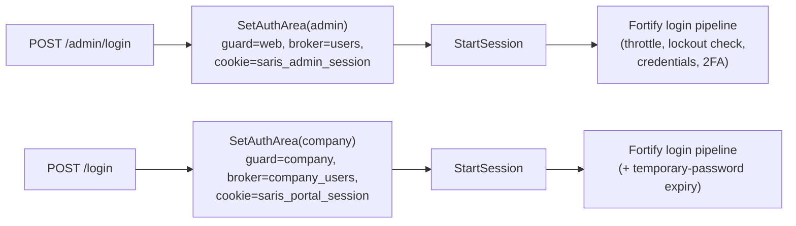
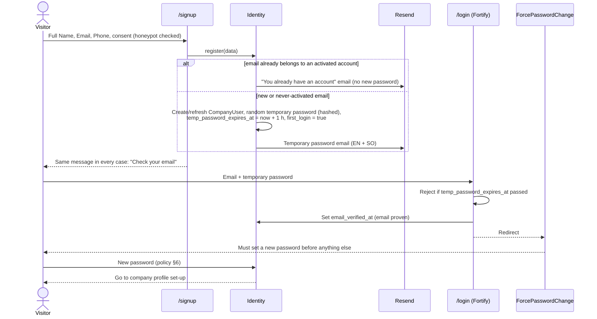
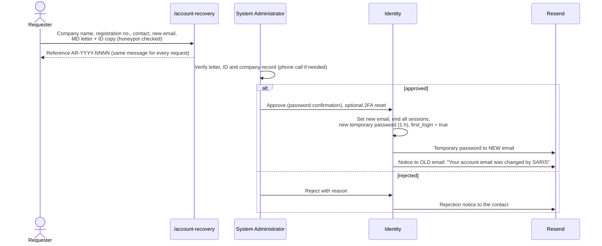

# Deliverable 3 — Authentication and Security

- Project: SARIS Company Portal
- Version: 1.1 (approved 2026-10-28)
- Date: 2026-10-28
- Based on: `docs/decisions-log.md` (D-001 to D-078), `docs/design/01-architecture.md` (v2.1),
  `docs/design/02-data-model.md` (v1.1), `docs/design/00-current-state.md`

---

## 1. Principles

1. **Two separate identity realms.** Staff (`users`, guard `web`) and companies
   (`company_users`, guard `company`) never share a table, guard, session or route group
   (D-048).
2. **Reuse proven code.** Fortify handles login, logout, password reset and 2FA for both
   realms (D-062). Only the company sign-up form is new.
3. **Deny by default.** Every route requires authentication unless it is explicitly public;
   every action checks a permission or a company-ownership policy.
4. **Least privilege and segregation of duties.** No role can bypass the workflow (D-051).
5. **Everything is logged.** Security and business events go to an append-only audit log
   (D-055).
6. **Defence in depth.** DigitalOcean Cloud Firewall and ufw, Nginx (TLS, rate limits),
   then Laravel middleware, policies and database constraints. Cloudflare is used only for
   R2 file storage, not in front of the domain (D-094).

---

## 2. Identity Realms

| | Staff (Admin Portal) | Company (Company Portal) |
|---|---|---|
| Table / model | `users` / `App\Models\User` | `company_users` / `App\Models\CompanyUser` |
| Guard | `web` | `company` |
| Password broker | `users` | `company_users` |
| Auth URLs | `/admin/login`, `/admin/forgot-password`, `/admin/reset-password`, `/admin/two-factor-challenge` | `/login`, `/forgot-password`, `/reset-password`, `/two-factor-challenge`, plus `/signup`, `/temporary-password` |
| App URLs | `/admin/*` | `/portal/*` |
| Session cookie | `saris_admin_session` | `saris_portal_session` |
| How accounts are created | System Administrator (§5.2) | Self sign-up (§4) |
| 2FA | **Mandatory** TOTP (D-052) | Optional TOTP (D-064) |
| Roles | spatie roles (D-023, D-051) | None; full rights over own company (D-001) |

---

## 3. Fortify for Both Portals (D-062)

Fortify is built for one guard. It serves both realms as follows:

1. `Fortify::ignoreRoutes()` stops Fortify registering its default routes.
2. Fortify's own controllers are registered twice: in `routes/admin.php` under the `/admin`
   prefix, and in `routes/portal.php` for the company auth URLs.
3. A middleware **`SetAuthArea`** runs first on each group and sets, for that request only:
   - `fortify.guard` → `web` or `company`
   - `fortify.passwords` → `users` or `company_users`
   - `fortify.home` → `/admin` or `/portal`
   - `session.cookie` → `saris_admin_session` or `saris_portal_session`
   - the area name, used by the Fortify view callbacks to render the admin or company
     Inertia page.
4. `SetAuthArea` must run **before** `StartSession`, so each area uses its own cookie.
5. Rate-limiter keys include the area, so attempts on one portal never affect the other.

**Mandatory tests:**
- A staff account cannot log in at `/login`, and a company account cannot log in at `/admin/login`.
- A company session cannot open any `/admin/*` page, and a staff session cannot open any `/portal/*` page.
- Password reset links from one broker don't work in the other area.
- Logging in to one area does not log the browser in or out of the other.

---

## 4. Company Sign-up and First Login (D-063)

| Rule | Detail |
|---|---|
| Temporary password | 12 random characters (letters and digits, no look-alike characters), stored only as a hash |
| Validity | 1 hour from sending (D-063) |
| New temporary password | "Send me a new temporary password" at `/temporary-password`; only for accounts that have never logged in; invalidates the previous one |
| No enumeration | Sign-up, temporary-password and forgot-password forms always show the same message, whether or not the email exists |
| Bot protection | Hidden honeypot field and a minimum fill time (3 seconds) on sign-up, temporary-password, forgot-password and account-recovery forms, plus rate limits; no outside service (D-080) |
| Consent | Sign-up records `terms_accepted_at` against the privacy notice (H5) |
| Phone | Stored in international format (`+252…`, D-076); not verified in Phase 1 (no SMS, D-030) |

---

## 5. Account Lifecycle

### 5.1 Company accounts

| Event | Behaviour |
|---|---|
| Sign-up | §4 |
| Password forgotten | Fortify reset link by email (60 minutes, single use) |
| Login email change | Account holder requests it after password confirmation; a confirmation link goes to the new address (valid 60 minutes) and a notice to the old address; the email changes only when the link is used (D-093) |
| Email access lost | Public account recovery (§10) |
| 2FA device lost | Recovery codes; otherwise account recovery with 2FA reset (D-064) |
| Deactivation | Staff set `status = INACTIVE` (e.g. on a confirmed takeover); `EnsureUserIsActive` logs the user out |
| Deletion | Never (D-034, D-053) |

### 5.2 Staff accounts

| Event | Behaviour |
|---|---|
| Creation | System Administrator enters name, email, phone and roles. The system emails a **temporary password valid 24 hours**; the administrator never sees or types a password |
| First login | Forced password change (`first_login = true`), then mandatory 2FA set-up |
| Role change | System Administrator only; audit-logged with before/after roles |
| 2FA reset | System Administrator, after verifying the person face to face; the user must enrol again at next login; audit-logged |
| Leaving SARIS | Deactivated (`INACTIVE`), never deleted; all sessions end immediately |
| Unused account | Accounts with no login for 90 days are listed for the System Administrator to review |

---

## 6. Password Policy

| Rule | Value |
|---|---|
| Minimum length | 12 characters |
| Composition | Upper and lower case, a number and a symbol |
| Breached passwords | Rejected using the "uncompromised" check (Have I Been Pwned k-anonymity API) |
| Applies to | Both realms, every environment except automated tests, including passwords set by staff flows (fixes current-state gap 15) |
| Reuse | The new password must differ from the **last 5** passwords (stored as hashes in `password_histories`) |
| Expiry | **Every 90 days** for staff and companies (D-082). A reminder email is sent 14 days before; after expiry the user must set a new password at the next login before doing anything else. Also forced on first login, after recovery, or if compromise is suspected |
| Hashing | bcrypt, cost 12 (Laravel default) |
| Password change | Logs out all other sessions of that account |

---

## 7. Login Protection and Lockout

| Control | Value |
|---|---|
| Throttle (existing) | 5 login attempts per minute per email + IP; 5 two-factor attempts per minute |
| Account lockout | After **5 consecutive failed attempts**, the account is locked for **15 minutes**; the counter resets after a successful login |
| Lockout notice | Email to the account owner: "Your account was locked after failed sign-in attempts" |
| Early unlock | Company: completing a password reset unlocks the account. Staff: the System Administrator can unlock |
| Error messages | Always "These credentials do not match our records"; never reveals whether the email exists or the account is locked until the correct password is given |
| Server protection | Nginx `limit_req` zones on `/login`, `/admin/login`, `/signup` and all password forms; fail2ban bans IPs with repeated failures (D-094) |

Lockout is implemented in Fortify's login pipeline (`authenticateUsing` and a custom
pipeline step), using `failed_login_attempts` and `locked_until` (02-data-model §4.1).

---

## 8. Two-Factor Authentication (D-037, D-052, D-064)

| | Staff | Company |
|---|---|---|
| Method | TOTP authenticator app (Fortify, existing pages) | Same |
| Required | Yes. `EnsureTwoFactorEnabled` middleware on every `/admin/*` route redirects to set-up until 2FA is confirmed | No; optional in settings |
| Recovery codes | 8 single-use codes, shown once | Same |
| Lost device and codes | System Administrator reset (§5.2) | Approved account recovery with 2FA reset (D-064) |
| Disable 2FA | Not allowed for staff | Allowed after password confirmation |

---

## 9. Sessions

| Setting | Staff | Company |
|---|---|---|
| Cookie | `saris_admin_session` | `saris_portal_session` |
| Flags | `Secure`, `HttpOnly`, `SameSite=Lax` | Same |
| Storage | Database driver, payload encrypted (`SESSION_ENCRYPT=true`) | Same |
| Idle timeout | 15 minutes | 30 minutes |
| Absolute limit | 12 hours, then log in again | None beyond idle |
| "Remember me" | Disabled | Disabled |
| On login | Session ID regenerated | Same |
| On logout | Session invalidated and CSRF token regenerated | Same |
| Deactivated account | Logged out on the next request (`EnsureUserIsActive`) | Same |

Autosaved drafts (D-046) mean a timed-out company user loses no work.

### Password confirmation for sensitive actions

The user re-enters their password (Fortify `password.confirm`). The confirmation is valid
for 15 minutes for staff and 30 minutes for companies.

| Realm | Actions |
|---|---|
| Staff | DG decision; license issue; payment clearance; inspection report signing (D-077); enforcement actions; role and user changes; account recovery decisions; national-ID release; 2FA reset |
| Company | Submitting an application (declaration); changing 2FA settings |

---

## 10. Account Recovery (D-003, D-064)

- Limited to 3 requests per IP per day, with the honeypot check.
- Uploaded files follow the upload rules in §12.
- The System Administrator handles recovery requests (D-095).

---

## 11. Authorization

### 11.1 Staff: roles and permissions (D-023, D-051)

Permissions are fine-grained (`<action> <subject>`) and grouped into roles. Workflow actions
are checked **twice**: the user must hold the role for the stage in the WorkflowTransition,
**and** any stage assignment must match. For example, only the assigned Inspector can
submit that inspection report, and only the assigned Technical Reviewer can complete that
review.

| Capability | Sys Admin | Registrar | Tech Reviewer | Inspector | Dept Director | Payment Officer | DG / delegate | Records Officer |
|---|---|---|---|---|---|---|---|---|
| Manage staff users and roles | ✓ | | | | | | | |
| Manage reference data, fees, restricted list | ✓ | | | | | | | |
| View applications and company files | | ✓ | assigned | assigned | ✓ | ✓ | ✓ | ✓ |
| Acknowledge, admin review, technical review, consolidated review | | ✓ | technical review only | | | | | |
| Return to company | | ✓ | | | | | ✓ (Defer) | |
| Assign Technical Reviewer, schedule inspection | | ✓ | | | | | | |
| Record and sign inspection report | | | | ✓ | | | | |
| Recommend / return to Registrar | | | | | ✓ | | | |
| Issue permission-to-pay letter; clear or reject payment | | | | | | ✓ | | |
| Approve / defer / reject | | | | | | | ✓ | |
| Prepare and issue license | | | | | | | | ✓ |
| Verify products | | ✓ | | | | | | |
| Request suspension / cancellation | | ✓ | | | ✓ | | | |
| Approve enforcement action | | | | | | | ✓ | |
| Account recovery, national-ID release | ✓ | | | | | | | |
| View audit log | ✓ (security events) | | | | ✓ | | ✓ | |

### 11.2 Segregation of duties

These rules are enforced in the Workflow module, not just by role assignment:

1. The System Administrator role cannot be combined with any workflow role.
2. On the same application, one person cannot both:
   - make the Director recommendation and the DG decision;
   - clear the payment and make the DG decision;
   - issue the permission-to-pay letter for an application they reviewed as Registrar.
3. A DG delegate can act only between `starts_on` and `ends_on`, and is recorded as acting
   on behalf of the DG (D-027).
4. Staff can never edit application data (D-026); the only write actions are the workflow
   actions and their comments.

### 11.3 Companies: ownership and locks

| Control | Implementation |
|---|---|
| Ownership | A global scope on every company-owned model filters by the logged-in user's `company_id`; route model binding goes through the scope, so another company's ID returns 404 |
| Edit lock (D-073) | Policies allow updates to profile, persons and premises only before the first submission or while a Company/Operator License application is `DRAFT` or `RETURNED` |
| Exceptions | Products (any time, back to verification, D-039); renewed commerce and tax certificates (any time, staff notified) |
| Business rules | Import Permit prerequisites, banned ingredients and certificate expiry are checked server-side at submission (D-015, D-017, D-021) |
| Files | A download is allowed only if the file belongs to the user's company, or to an application or license the staff member may view; then a 5-minute signed URL is issued (D-056) |

---

## 12. Data Protection and Application Security

### 12.1 Sensitive data

| Data | Protection |
|---|---|
| Passwords, temporary passwords | bcrypt hashes only |
| 2FA secrets, recovery codes | Encrypted (Fortify) |
| National ID numbers | Encrypted at rest (Laravel `encrypted` cast) **plus** an HMAC-SHA256 hash column used for the unique index and lookups. This implements D-066 without storing IDs in plain text |
| Sessions | Encrypted payload |
| Files | Private R2 bucket, signed URLs, never public |
| Backups | Encrypted before upload to the separate R2 bucket (D-059) |
| Logs | Passwords, tokens and national IDs are never written to logs; national IDs are masked in audit entries (`****1234`) |
| Public verification page | Only number, company name, type, status and validity (D-012) |

### 12.2 Uploads

| Check | Rule |
|---|---|
| Type | Allow-list PDF, JPG, PNG (D-017); the type is detected from the **file content**, not the name or browser header |
| Size | 5 MB for companies; inspection video limit pending (open question in log) |
| Images | Re-encoded on the server, which removes metadata and any hidden payload |
| PDFs | Rejected if encrypted or containing JavaScript |
| Storage | New random key per file; original name kept only as metadata |
| Download | Served with `Content-Disposition: attachment` and the stored MIME type |
| Antivirus | Deferred to Phase 2 (ClamAV in the queue) |

### 12.3 Web application controls (OWASP Top 10)

| OWASP 2021 | Controls |
|---|---|
| A01 Broken access control | Separate guards and route groups; company global scope; permission plus assignment checks; segregation of duties; separation tests |
| A02 Cryptographic failures | TLS 1.2+ on Nginx with a Let's Encrypt certificate (auto-renewed), HTTP redirected to HTTPS, HSTS; encrypted national IDs, sessions and backups; bcrypt |
| A03 Injection | Eloquent and query-builder bindings only; no raw SQL with user input; React escaping; no `dangerouslySetInnerHTML` |
| A04 Insecure design | Business rules in backend services; workflow transitions from configuration; immutable snapshots |
| A05 Security misconfiguration | `APP_DEBUG=false` in production; generic error pages; local file serving disabled; Passport and Jetstream removed (D-049); security headers (below) |
| A06 Vulnerable components | `composer audit` and `npm audit` in CI; monthly dependency updates |
| A07 Identification and authentication failures | Fortify; lockout; strong password policy with 90-day expiry and history; mandatory staff 2FA; honeypot; no enumeration |
| A08 Software and data integrity | Lock files committed; CI checks; snapshot hashes; deployment only from `main` |
| A09 Logging and monitoring failures | Append-only audit log (§13); alerts on lockouts and repeated failures |
| A10 SSRF | The app does not fetch user-supplied URLs; outbound calls only to Resend, R2 and the breached-password API |

**Security headers** (Laravel middleware; HSTS set by Nginx):
- `Content-Security-Policy` with per-request nonces for Inertia scripts; no inline scripts without a nonce;
- `X-Frame-Options: DENY` (or CSP `frame-ancestors 'none'`);
- `X-Content-Type-Options: nosniff`;
- `Referrer-Policy: strict-origin-when-cross-origin`;
- `Permissions-Policy` allowing the camera only on upload pages and geolocation only for Inspectors.

**CSRF:** Laravel's built-in protection, which Inertia already uses.
**Mass assignment:** explicit `$fillable` on every model.

### 12.4 Infrastructure (D-057)

- **Network:** A DigitalOcean Cloud Firewall and ufw allow only SSH (restricted to SARIS admin IPs where possible), HTTP (redirect only) and HTTPS. MySQL listens on localhost only.
- **Access:**
  - SSH by key only, with password login disabled; fail2ban.
  - Automatic security updates.
  - Its own Linux user and PHP-FPM pool, isolated from other sites.
  - A database user with privileges on the portal database only.
- **Secrets:** stored only in `.env` on the server and never committed. The R2 keys are limited to the portal's buckets, and keys are rotated when staff leave.
- **Web server:** Nginx with a Let's Encrypt certificate (certbot auto-renewal), TLS 1.2+, HSTS, `limit_req` rate-limit zones, request size limit (10 MB for company routes), and fail2ban jails for repeated login failures and scanning.
- **Known limit:** without an edge proxy, the droplet IP is public and there is no edge DDoS protection or WAF. This is accepted for Phase 1 (D-094); Cloudflare or another proxy can be added later without code changes.

---

## 13. Audit Logging (D-055)

| Category | Events |
|---|---|
| Authentication | Login success and failure, lockout, logout, temporary password sent, password change and reset, 2FA enabled, disabled or reset, recovery code used |
| Accounts | Staff created, deactivated, roles changed; account recovery submitted, approved, rejected; national-ID release |
| Company data | Profile, person, premises, document and product create/update (before and after values) |
| Workflow | Every WorkflowAction (also kept in its own table) |
| Payments | Letter issued, receipt uploaded, cleared, rejected |
| Licensing | License prepared, issued, superseded, expired, enforcement actions |
| Data access | Staff viewing or downloading company documents, IDs and receipts |

Each entry records: actor type and ID, role used, IP, user agent, time, subject, event, and
before/after values with sensitive fields masked.

**Append-only:** the application never updates or deletes audit rows, and MySQL triggers
reject `UPDATE` and `DELETE` on the audit table. Entries are kept forever (D-034).

---

## 14. Rate Limits Summary

| Endpoint | Limit |
|---|---|
| Login (each area) | 5 / minute per email + IP, plus lockout (§7) |
| Two-factor challenge | 5 / minute per session |
| Sign-up | 3 / hour per IP, plus honeypot |
| New temporary password | 3 / hour per email, plus honeypot |
| Forgot password | 3 / hour per email, plus honeypot |
| Account recovery request | 3 / day per IP, plus honeypot |
| Public verification `/verify/{code}` | 60 / minute per IP |
| File uploads | 30 / minute per user |
| Other authenticated requests | 120 / minute per user |

---

## 15. Required Security Tests

1. Cross-portal login rejection, both directions (§3).
2. Cross-portal route access with a valid session from the other area returns 403 or a redirect to that area's login.
3. A company cannot read, update or download another company's records or files, by changing IDs.
4. Each workflow action is refused without the stage role, without the assignment, and by a user who breaks a segregation rule (§11.2).
5. The D-073 edit lock is enforced for every profile, person and premises update route.
6. An expired temporary password is rejected; a new one invalidates the previous one.
7. Lockout after 5 failures, and unlock after 15 minutes or a password reset.
8. Staff without confirmed 2FA cannot open any admin page.
9. Sign-up, temporary-password and forgot-password responses are identical for existing and unknown emails.
10. Upload validation rejects a renamed executable, an oversized file and a PDF with JavaScript.
11. Audit rows cannot be updated or deleted.
12. A delegate cannot act as DG outside the delegation dates.

---

## Open questions

None for this deliverable.

## Assumptions made

- [ASSUMPTION] Outbound HTTPS to the breached-password API is allowed from the droplet.

## Decisions (confirmed 2026-10-28)

| Decision | Summary |
|---|---|
| D-079 | Fortify wiring: `Fortify::ignoreRoutes()`, controllers registered in both route files, a `SetAuthArea` middleware (before `StartSession`) sets the guard, broker, home and session cookie per area. |
| D-080 | Public forms use a hidden honeypot field, a minimum fill time and rate limits (no outside CAPTCHA service); identical responses prevent email enumeration. |
| D-081 | Account lockout: 5 consecutive failures lock the account for 15 minutes; email notice; System Administrator can unlock staff; a password reset unlocks companies. |
| D-082 | Password policy in both realms and all environments: 12+ characters, mixed case, number, symbol, not breached; expires every 90 days with a reminder 14 days before; the last 5 passwords cannot be reused; a password change ends other sessions. |
| D-083 | Staff accounts are created with an emailed temporary password valid 24 hours; the administrator never sets passwords. |
| D-084 | Sessions: separate encrypted cookies (`Secure`, `HttpOnly`, `SameSite=Lax`); idle timeout 15 minutes staff and 30 minutes companies; 12-hour absolute limit for staff; no "remember me". |
| D-085 | Password re-confirmation for the sensitive actions listed in §9 (15 minutes staff, 30 minutes companies). |
| D-086 | Segregation of duties rules in §11.2. |
| D-087 | Staff 2FA reset by the System Administrator after face-to-face verification; re-enrolment at next login. |
| D-088 | National IDs encrypted at rest, with an HMAC hash column for uniqueness and lookup (implements D-066). |
| D-089 | Upload security in §12.2; antivirus scanning deferred to Phase 2. |
| D-090 | Security headers including a nonce-based CSP; TLS on Nginx with Let's Encrypt and HSTS. |
| D-091 | Append-only audit log enforced by database triggers; staff views and downloads of company documents are logged. |
| D-092 | Account recovery approval ends all sessions, sends a temporary password to the new email and a notice to the old email. |
| D-093 | The company can change its own login email: password confirmation, link to the new address, notice to the old address. |
| D-094 | Cloudflare is used only for R2 storage, not in front of the domain. Nginx serves the domain directly with Let's Encrypt TLS, rate limits and fail2ban, behind a DigitalOcean Cloud Firewall and ufw. |
| D-095 | The System Administrator handles account recovery requests and national-ID releases (extends D-051; still no workflow permissions). |
