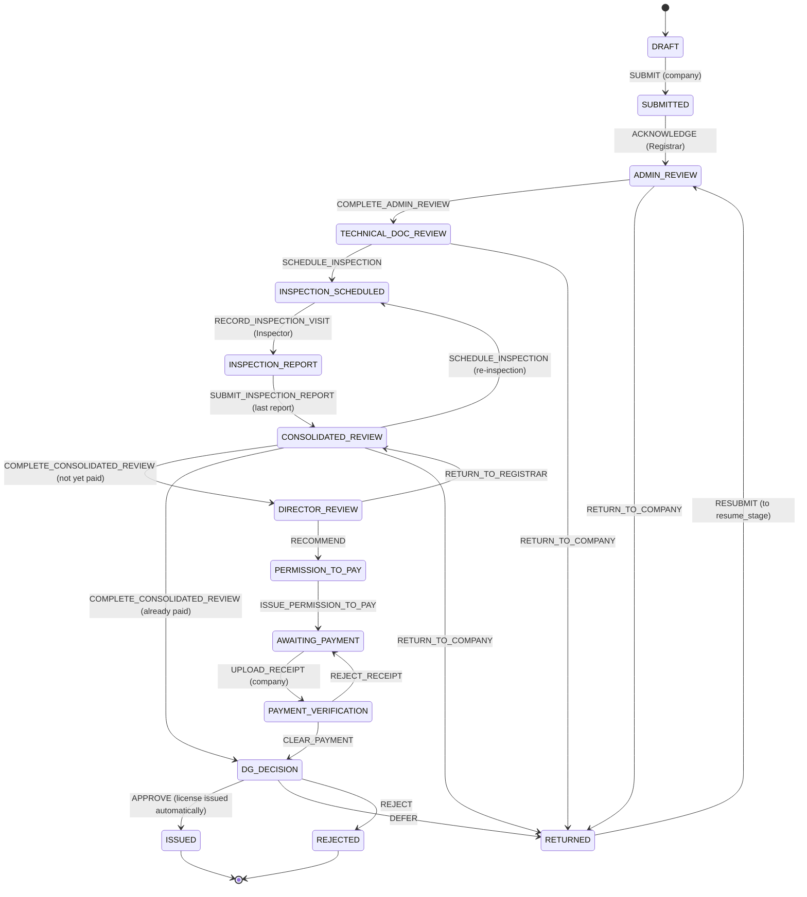
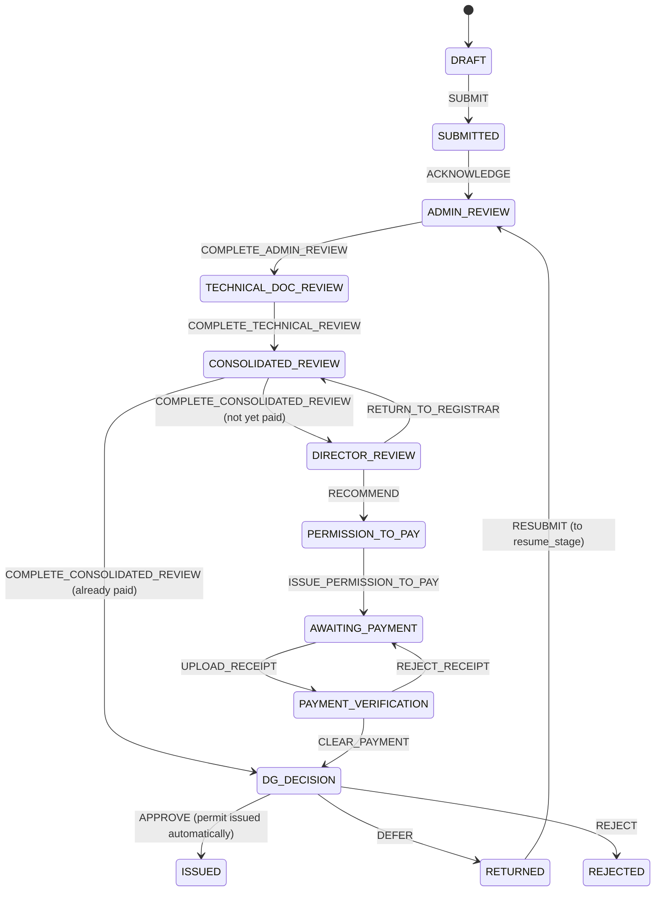
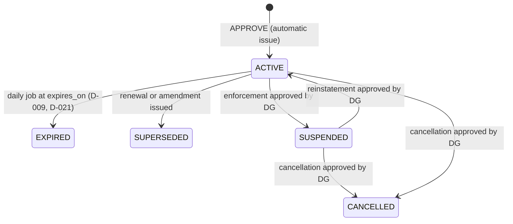

# Deliverable 4 — Configurable Workflow Engine

- Project: SARIS Company Portal
- Version: 1.1 (approved 2026-10-28)
- Date: 2026-10-28
- Based on: `docs/decisions-log.md` (D-001 to D-095), `docs/requirements-answers.md`
  (section W, written procedure 6.1–6.14), `docs/design/02-data-model.md` (v1.2),
  `docs/design/03-auth-security.md` (v1.1)

---

## 1. Purpose

The workflow engine moves every application from `DRAFT` to a final status (`ISSUED` or
`REJECTED`). Companies cannot withdraw a submitted application (D-101). It decides **who** may do **what**, **when**, checks the business
rules, runs the side effects (snapshots, letters, licenses, emails) and records an immutable
history.

The engine is **generic**. The three Phase 1 services are three **workflow definitions**
(configuration), not three pieces of code (D-041, D-071). A new service, or the Operator
License and Import Permit procedures when SARIS sends them, is added by writing a new
definition and, at most, new guard or effect classes.

---

## 2. Concepts

| Concept | Meaning | Stored in |
|---|---|---|
| **Workflow definition** | All stages and transitions for one service, with a version | `config/workflows/<code>.php` → `workflow_templates` |
| **Stage** | A status the application can be in (e.g. `ADMIN_REVIEW`), with the role that works on it and the simplified label the company sees | `workflow_stages` |
| **Transition** | "From stage X, actor Y may perform action Z, which moves to stage W" | `workflow_transitions` |
| **Actor** | `COMPANY` or a staff role code (§3) | transition `actor_role` |
| **Guard** | A named rule that must pass before the transition runs (e.g. `ImportationLicenseActive`) | transition `guards` |
| **Effect** | A named step run inside the transition (e.g. `CreateVersionSnapshot`) | transition `effects` |
| **Workflow action** | The immutable record that a transition happened | `workflow_actions` |

An application keeps the definition **version** it started with (`applications.workflow_template_id`).
Changing a definition creates a new version; running applications are not affected.

---

## 3. Actors

| Role code | Role (D-023) | Notes |
|---|---|---|
| `COMPANY` | Company account holder | Company Portal only |
| `REGISTRAR` | Pesticide Registrar | |
| `TECHNICAL_REVIEWER` | Technical Reviewer | Only when **assigned** to the application |
| `INSPECTOR` | Inspector | Only for inspections **assigned** to them |
| `DEPARTMENTAL_DIRECTOR` | Departmental Director | |
| `PAYMENT_OFFICER` | Payment Officer | |
| `DIRECTOR_GENERAL` | Director General | Or an active delegate (D-027) |
| `SYSTEM` | The application itself | Automatic transitions only |

The System Administrator has **no** workflow actor code (D-051, D-086).

---

## 4. How a Transition Runs

```mermaid
sequenceDiagram
    actor U as User (company or staff)
    participant C as Controller
    participant E as WorkflowEngine
    participant DB as Database (one transaction)
    participant Q as Queue (after commit)

    U->>C: action + expected_status + payload
    C->>E: perform(application, action, actor, payload)
    E->>DB: BEGIN; lock application row (SELECT … FOR UPDATE)
    E->>E: 1. status still = expected_status? else 409 "already processed"
    E->>E: 2. find transition (current stage + action) in the app's template version
    E->>E: 3. actor check: realm, role, assignment, delegation
    E->>E: 4. password confirmed? (if required, D-085)
    E->>E: 5. payload check: comment, review items, fields
    E->>E: 6. guards (business rules, segregation of duties)
    alt any check fails
        E->>DB: ROLLBACK
        E-->>U: error with clear reasons (nothing changed)
    else all pass
        E->>DB: 7. effects (snapshot, letter, license, payment…)
        E->>DB: 8. update status (and resume_stage, open_key)
        E->>DB: 9. insert WorkflowAction + audit entry
        E->>DB: COMMIT
        E->>Q: 10. emails, PDF generation (after commit)
        E-->>U: success, new status
    end
```

Rules:

1. **One transaction.** Effects, status change and history are saved together or not at all.
2. **No double processing.** The row lock plus `expected_status` mean two staff members clicking
   at the same time cannot both act; the second sees "already processed".
3. **Slow work after commit.** PDFs and emails run on the queue only after the transaction has
   succeeded (D-058), so a failed transition never sends an email.
4. **Every check runs on the server**, whatever the UI shows (D-015, D-086).
5. **The UI asks the engine** which actions the current user can perform
   (`availableActions(application, user)`), so buttons always match the rules.

---

## 5. Company License Workflow (`COMPANY_LICENSE_V1`)

Source: written procedure 6.1–6.13 (D-022).



There is no withdrawal (D-101). A draft that was never submitted can still be discarded by
the company.

### 5.1 Stages

| Stage | Works on it | Company sees | Edit allowed for company |
|---|---|---|---|
| `DRAFT` | Company | Draft | Yes, including profile (D-073) |
| `SUBMITTED` | Registrar | Submitted | No |
| `ADMIN_REVIEW` | Registrar | Under Review | No |
| `TECHNICAL_DOC_REVIEW` | Registrar (+ assigned Technical Reviewer) | Under Review | No |
| `INSPECTION_SCHEDULED` | Assigned Inspector | Inspection Scheduled (date shown) | No |
| `INSPECTION_REPORT` | Assigned Inspector | Under Review | No |
| `CONSOLIDATED_REVIEW` | Registrar | Under Review | No |
| `DIRECTOR_REVIEW` | Departmental Director | Under Review | No |
| `PERMISSION_TO_PAY` | Payment Officer | Under Review | No |
| `AWAITING_PAYMENT` | Company | Payment Required | Receipt upload only |
| `PAYMENT_VERIFICATION` | Payment Officer | Payment Under Verification | No |
| `DG_DECISION` | Director General / delegate | Under Review | No |
| `ISSUED` | — (final) | Approved | No |
| `RETURNED` | Company | Action Required | Yes, including profile (D-073) |
| `REJECTED` | — (final) | Rejected | No |

### 5.2 Transition matrix

| # | From | Action | Actor | To | Guards | Effects |
|---|---|---|---|---|---|---|
| T1 | `DRAFT` | `SUBMIT` | COMPANY (password confirmed) | `SUBMITTED` | ProfileComplete, CertificatesValid, RequiredDocuments, ChecklistPhotos, TechnicalPersonSelected, NoOtherOpenApplication, RenewalWindowOpen*, PreviousLicenseActive* | GenerateReference, CreateVersionSnapshot, SetOpenKey, SetLateRenewalFlag*, Notify(SUBMITTED) |
| T2 | `SUBMITTED` | `ACKNOWLEDGE` | REGISTRAR | `ADMIN_REVIEW` | — | Notify(ACKNOWLEDGED) |
| T3 | `ADMIN_REVIEW` | `COMPLETE_ADMIN_REVIEW` | REGISTRAR | `TECHNICAL_DOC_REVIEW` | ReviewItemsAllCompliant(ADMIN_REVIEW) | — |
| T4 | `ADMIN_REVIEW` | `RETURN_TO_COMPANY` | REGISTRAR | `RETURNED` | ReviewItemsHaveDeficiency(ADMIN_REVIEW), comment | SetResumeStage(ADMIN_REVIEW), Notify(RETURNED) |
| T5 | `TECHNICAL_DOC_REVIEW` | `ASSIGN_TECHNICAL_REVIEWER` | REGISTRAR | same | Assignee has TECHNICAL_REVIEWER role | CreateAssignment, Notify(ASSIGNED) |
| T6 | `TECHNICAL_DOC_REVIEW` | `COMPLETE_TECHNICAL_REVIEW` | assigned TECHNICAL_REVIEWER | same | ReviewItemsRecorded(TECHNICAL_DOC_REVIEW) | EndAssignment, Notify(REVIEW_DONE → Registrar) |
| T7 | `TECHNICAL_DOC_REVIEW` | `SCHEDULE_INSPECTION` | REGISTRAR | `INSPECTION_SCHEDULED` | ReviewItemsAllCompliant(TECHNICAL_DOC_REVIEW), NoOpenAssignment, inspector + planned date per premises | CreateInspections, Notify(INSPECTION_SCHEDULED → company, Inspector) |
| T8 | `TECHNICAL_DOC_REVIEW` | `RETURN_TO_COMPANY` | REGISTRAR | `RETURNED` | ReviewItemsHaveDeficiency(TECHNICAL_DOC_REVIEW), comment | SetResumeStage(TECHNICAL_DOC_REVIEW), Notify(RETURNED) |
| T9 | `INSPECTION_SCHEDULED` | `RESCHEDULE_INSPECTION` | REGISTRAR | same | new date, comment | UpdateInspectionDate, Notify(INSPECTION_RESCHEDULED) |
| T10 | `INSPECTION_SCHEDULED` | `RECORD_INSPECTION_VISIT` | assigned INSPECTOR | `INSPECTION_REPORT` | — | SetConductedAt |
| T11 | `INSPECTION_REPORT` | `SUBMIT_INSPECTION_REPORT` | assigned INSPECTOR (password confirmed) | `CONSOLIDATED_REVIEW` if this is the last unsigned inspection, otherwise same | InspectionReportComplete | SignInspection, Notify(REPORT_SUBMITTED → Registrar) |
| T12 | `CONSOLIDATED_REVIEW` | `COMPLETE_CONSOLIDATED_REVIEW` | REGISTRAR | `DIRECTOR_REVIEW`; **`DG_DECISION` if a payment is already cleared** (D-043) | ReviewItemsAllCompliant(CONSOLIDATED_REVIEW), InspectionsSigned | — |
| T13 | `CONSOLIDATED_REVIEW` | `RETURN_TO_COMPANY` | REGISTRAR | `RETURNED` | ReviewItemsHaveDeficiency(CONSOLIDATED_REVIEW), comment | SetResumeStage(CONSOLIDATED_REVIEW), Notify(RETURNED) |
| T14 | `CONSOLIDATED_REVIEW` | `SCHEDULE_INSPECTION` | REGISTRAR | `INSPECTION_SCHEDULED` | comment (reason for re-inspection) | CreateInspections, Notify(INSPECTION_SCHEDULED) |
| T15 | `DIRECTOR_REVIEW` | `RECOMMEND` | DEPARTMENTAL_DIRECTOR | `PERMISSION_TO_PAY` | Segregation | Notify(→ Payment Officer) |
| T16 | `DIRECTOR_REVIEW` | `RETURN_TO_REGISTRAR` | DEPARTMENTAL_DIRECTOR | `CONSOLIDATED_REVIEW` | comment | Notify(→ Registrar) |
| T17 | `PERMISSION_TO_PAY` | `ISSUE_PERMISSION_TO_PAY` | PAYMENT_OFFICER | `AWAITING_PAYMENT` | FeeScheduleExists, Segregation | IssuePermissionToPayLetter (fee from schedule, D-038), Notify(PAYMENT_REQUIRED, letter attached) |
| T18 | `AWAITING_PAYMENT` | `UPLOAD_RECEIPT` | COMPANY | `PAYMENT_VERIFICATION` | receipt number, date, amount, file | RecordPayment(SUBMITTED), Notify(→ Payment Officer) |
| T19 | `PAYMENT_VERIFICATION` | `CLEAR_PAYMENT` | PAYMENT_OFFICER (password confirmed) | `DG_DECISION` | AmountMatchesLetter, ReceiptNotUsed (D-074) | ClearPayment, Notify(PAYMENT_CLEARED) |
| T20 | `PAYMENT_VERIFICATION` | `REJECT_RECEIPT` | PAYMENT_OFFICER | `AWAITING_PAYMENT` | comment | RejectPayment, Notify(RECEIPT_REJECTED) |
| T21 | `DG_DECISION` | `APPROVE` | DIRECTOR_GENERAL or delegate (password confirmed) | `ISSUED` | PaymentCleared, Segregation, ActiveDelegation* | IssueLicense (number, LicenseSnapshot, QR code, `ACTIVE`, register; PDF job), SupersedePreviousLicense*, ClearAmendmentFlag*, ClearOpenKey, SetDecidedAt, Notify(ISSUED, after the PDF is ready) |
| T22 | `DG_DECISION` | `DEFER` | DIRECTOR_GENERAL or delegate | `RETURNED` | comment | SetResumeStage(CONSOLIDATED_REVIEW), Notify(RETURNED) |
| T23 | `DG_DECISION` | `REJECT` | DIRECTOR_GENERAL or delegate (password confirmed) | `REJECTED` | comment | ClearOpenKey, SetDecidedAt, Notify(REJECTED) |
| T25 | `RETURNED` | `RESUBMIT` | COMPANY (password confirmed) | value of `resume_stage` | Same as T1 (except reference) | CreateVersionSnapshot, ClearResumeStage, Notify(RESUBMITTED → staff) |

\* Only for renewal or amendment applications (§8), or only when a delegate acts.

### 5.3 Review checklists

`COMPLETE_*_REVIEW` and `RETURN_TO_COMPANY` depend on ReviewItems (02-data-model §4.7).
Every item for the stage must be recorded as `COMPLIANT`, `DEFICIENT` or
`CLARIFICATION_REQUIRED`; a non-compliant item needs a comment.

| Stage | Items |
|---|---|
| `ADMIN_REVIEW` (6.3) | `COMMERCE_REGISTRATION`, `TAX_COMPLIANCE`, `IDENTIFICATION`, `COMPANY_PROFILE`, `CATEGORY`, `APPLICATION_COMPLETENESS`, `SUPPORTING_DOCUMENTS` |
| `TECHNICAL_DOC_REVIEW` (6.4) | `TECHNICAL_QUALIFICATION`, `TECHNICAL_CV` (SOPs are checked on site, D-025) |
| `CONSOLIDATED_REVIEW` (6.8) | `DOCUMENTS_CONSISTENT`, `INSPECTION_REPORT_PRESENT`, `INSPECTION_FINDINGS_ADDRESSED`, `OVERALL_COMPLIANCE` |

Item lists are configuration. On resubmission, reviewers see the previous version's items and
the company's response next to the new version.

---

## 6. Operator License Workflow (`OPERATOR_LICENSE_V1`, interim)

Until SARIS sends the Operator License procedure (D-041), this definition **copies
`COMPANY_LICENSE_V1`** with these differences:

| Item | Difference |
|---|---|
| Category | None |
| Facility checklist required at submit | Form 2 items (adds `FUMIGATION_SHEETS`, `SAND_SNAKES`, `EQUIPMENT_INVENTORY`) |
| Documents required at submit | Adds `EQUIPMENT_INVENTORY` |
| Inspection items | Adds `FUMIGATION_EQUIPMENT` |
| License produced | `OPERATOR_LICENSE`, prefix `PCA` |
| Fee | Operator License row of the fee schedule |

---

## 7. Import Permit Workflow (`IMPORT_PERMIT_V1`, interim)

Until SARIS sends the Import Permit procedure: the Company License flow **without inspection**
(C3, D-025).



| Item | Difference from the Company License |
|---|---|
| Stages removed | `INSPECTION_SCHEDULED`, `INSPECTION_REPORT` |
| Technical review | `COMPLETE_TECHNICAL_REVIEW` by the Registrar (or assigned Technical Reviewer) moves to `CONSOLIDATED_REVIEW` |
| Submit guards | `ImportationLicenseActive` (D-015), `ProductVerified` (D-039), `IngredientNotBanned` (D-021), CertificatesValid, StoragePremisesSelected. No checklist photos, no technical person. `NoOtherOpenApplication` is **not** applied (D-072); `DuplicateProductWarning` shows a non-blocking warning |
| Submit effects | Adds `FlagRestrictedIngredient` (D-021) |
| Review items | `ADMIN_REVIEW`: `COMMERCE_REGISTRATION`, `TAX_COMPLIANCE`, `IMPORTATION_LICENSE`, `APPLICATION_COMPLETENESS`. `TECHNICAL_DOC_REVIEW`: `PRODUCT_REGISTRATION`, `PRODUCT_LABEL`, `REGISTERED_AND_INTENDED_USE`, `QUANTITY_AND_PURPOSE`, `ENTRY_DETAILS`. `CONSOLIDATED_REVIEW`: `OVERALL_COMPLIANCE` |
| APPROVE guards | Adds `ImportationLicenseActive` again (D-015): if the license was suspended, cancelled or expired meanwhile, the DG can only defer or reject |
| License produced | `IMPORT_PERMIT`, prefix `PCPIP`, valid 90 days (D-021) |
| Edit on return | Permit details only; the company profile stays locked (D-073) |

---

## 8. Application Types (New, Renewal, Amendment)

Renewal and amendment use the **same definition** as a new application of that service. The
differences are guards and effects that check `application_type`:

| Type | Extra guards at submit | Extra effects at issue |
|---|---|---|
| `NEW` | No Active license of the same service and category | — |
| `RENEWAL` | `PreviousLicenseActive`; `RenewalWindowOpen` (from 60 days before expiry until expiry, D-009) | `SetLateRenewalFlag` at submit when within 30 days of expiry. At issue: the new license is valid **from the day after the old license expires** (or from the approval date if the old one has already expired), for 1 year (D-107); the previous license becomes `SUPERSEDED` when the new one starts |
| `AMENDMENT` | `PreviousLicenseActive` | Previous license `SUPERSEDED`; company `amendment_required_at` cleared (D-066); new number and full validity (D-007, D-008) |

The fee row comes from the fee schedule by service, category and type (D-008, D-038).

---

## 9. Returns, Deferrals and Resubmission

| Situation | Who | Goes to | On resubmit, continues at | Payment |
|---|---|---|---|---|
| Deficient or unclear items | Registrar (`RETURN_TO_COMPANY`) | `RETURNED` | The Registrar stage that returned it (D-043) | Not yet paid |
| File not satisfactory | Departmental Director (`RETURN_TO_REGISTRAR`) | `CONSOLIDATED_REVIEW` (internal; company not involved) | — | Not yet paid |
| Re-inspection needed | Registrar (`SCHEDULE_INSPECTION` from consolidated review) | `INSPECTION_SCHEDULED` | — | Not yet paid |
| Receipt wrong | Payment Officer (`REJECT_RECEIPT`) | `AWAITING_PAYMENT` | — | New receipt uploaded |
| DG defers | DG (`DEFER`) | `RETURNED` | `CONSOLIDATED_REVIEW`, then **directly** to `DG_DECISION` (T12) | Kept, never paid twice (D-043) |

**While `RETURNED`:**
- The company sees every deficient or unclear item with its comment, plus any DG comment.
- It edits what is needed and writes a response note.
- Profile editing follows D-073: unlocked for Company and Operator License applications, but only permit details for an Import Permit.
- `RESUBMIT` creates a **new ApplicationVersion** (v2, v3, …).
- There is no time limit (C4).

**No withdrawal** (D-101). A submitted application ends only as `ISSUED` or `REJECTED`. A
`RETURNED` application stays open until the company resubmits it (C4); while it is open it
blocks a second application of the same service and category (D-044).

---

## 10. Role, Assignment, Delegation and Segregation Checks

For a staff action, the engine checks in this order:

1. **Realm:** the actor is a staff user (`web` guard) for staff actions, or the application's company account for `COMPANY` actions.
2. **Role:** the user holds the transition's role.
3. **Assignment:**
   - `TECHNICAL_REVIEWER` actions need an open StageAssignment for this user.
   - `INSPECTOR` actions need the inspection to be assigned to this user.
4. **Delegation:** a non-DG user may perform `DIRECTOR_GENERAL` actions only within an active Delegation. The WorkflowAction records `on_behalf_of_id` (D-027).
5. **Segregation** (D-086). On the same application:
   - The user who performed `RECOMMEND` cannot perform `APPROVE`, `DEFER` or `REJECT`.
   - The user who performed `CLEAR_PAYMENT` cannot perform `APPROVE`, `DEFER` or `REJECT`.
   - A user who recorded Registrar review items cannot perform `ISSUE_PERMISSION_TO_PAY`.
6. **Password confirmation** for the actions marked in §5.2 (D-085).

---

## 11. Guard Catalogue

| Guard | Rule | Source |
|---|---|---|
| ProfileComplete | Company profile, Owner/MD and address complete | D-073 |
| CertificatesValid | Current commerce and tax certificates exist and are not expired | D-017 |
| RequiredDocuments | All document types required by the service exist | D-017 |
| ChecklistPhotos | Each required checklist item on each selected premises is available with at least one photo | D-018 |
| TechnicalPersonSelected | One technical person with qualification, degree and CV | Form 1/2 |
| StoragePremisesSelected | One storage premises selected | 02 §4.6 |
| NoOtherOpenApplication | No other open application with the same `open_key` | D-044 |
| ImportationLicenseActive | Company has an `ACTIVE` Importation License | D-015 |
| ProductVerified | Product is `VERIFIED` | D-039 |
| IngredientNotBanned | Active ingredient not on the banned list | D-021 |
| PreviousLicenseActive | The license being renewed or amended is `ACTIVE` | D-009 |
| RenewalWindowOpen | Today is within 60 days before expiry and not after expiry | D-009 |
| ReviewItemsAllCompliant(stage) | All items of the stage recorded and compliant | 6.3, 6.4, 6.8 |
| ReviewItemsHaveDeficiency(stage) | At least one item deficient or needing clarification | D-024 |
| ReviewItemsRecorded(stage) | All items of the stage recorded | 6.4 |
| NoOpenAssignment | No unfinished Technical Reviewer assignment | 6.4 |
| InspectionReportComplete | All checklist items answered, facts recorded | 6.7 |
| InspectionsSigned | Every inspection of the current round is signed | 6.7 |
| FeeScheduleExists | A fee row exists for service, category and type, effective today | D-038 |
| AmountMatchesLetter | Receipt amount and currency equal the letter | D-028 |
| ReceiptNotUsed | Receipt number not already cleared | D-074 |
| PaymentCleared | A cleared payment exists | D-028 |
| Segregation | §10 rule 5 | D-086 |
| ActiveDelegation | Delegate is within the delegation dates | D-027 |

## 12. Effect Catalogue

| Effect | What it does |
|---|---|
| GenerateReference | `CL-`, `OL-`, `IP-YYYY-NNNNN` on first submit (D-075) |
| CreateVersionSnapshot | New ApplicationVersion with JSON snapshot and hash (D-042, D-069) |
| SetOpenKey / ClearOpenKey | Maintain the one-open-application rule (D-044, D-072) |
| SetResumeStage / ClearResumeStage | Remember where a returned application continues (D-043) |
| SetLateRenewalFlag | Mark renewals submitted within 30 days of expiry (D-009) |
| FlagRestrictedIngredient | Set `has_restricted_ingredient` (D-021) |
| CreateAssignment / EndAssignment | Technical Reviewer assignment |
| CreateInspections / UpdateInspectionDate / SetConductedAt / SignInspection / CancelOpenInspections | One inspection per premises (D-077) |
| IssuePermissionToPayLetter | Letter number, fee copied from schedule, PDF job (D-028, D-038) |
| RecordPayment / ClearPayment / RejectPayment | Payment rows and statuses (D-074) |
| IssueLicense | At DG approval: license number, LicenseSnapshot from the approved version, verification code, status `ACTIVE`, register updated, PDF generated on the queue with the DG (or delegate) signature image, stamp image and QR code (D-106) |
| SupersedePreviousLicense | Previous license `SUPERSEDED`, linked (D-007) |
| ClearAmendmentFlag | Clear `companies.amendment_required_at` |
| Notify(template) | Queue the email after commit (detailed in Deliverable 7) |

---

## 13. Definition Format

Definitions are PHP files in `config/workflows/`, loaded into the workflow tables by a
seeder/command (D-071). Example (abridged):

```php
// config/workflows/company_license_v1.php
return [
    'code'    => 'COMPANY_LICENSE_V1',
    'service' => 'COMPANY_LICENSE',
    'version' => 1,
    'stages'  => [
        ['code' => 'DRAFT',        'actor' => 'COMPANY',   'company_status' => 'Draft'],
        ['code' => 'ADMIN_REVIEW', 'actor' => 'REGISTRAR', 'company_status' => 'Under Review',
         'review_items' => ['COMMERCE_REGISTRATION', 'TAX_COMPLIANCE', /* … */]],
        // …
    ],
    'transitions' => [
        ['from' => 'ADMIN_REVIEW', 'action' => 'COMPLETE_ADMIN_REVIEW', 'actor' => 'REGISTRAR',
         'to' => 'TECHNICAL_DOC_REVIEW',
         'guards' => ['ReviewItemsAllCompliant:ADMIN_REVIEW']],
        ['from' => 'CONSOLIDATED_REVIEW', 'action' => 'COMPLETE_CONSOLIDATED_REVIEW',
         'actor' => 'REGISTRAR',
         'to' => ['DG_DECISION' => 'PaymentCleared', 'default' => 'DIRECTOR_REVIEW'],
         'guards' => ['ReviewItemsAllCompliant:CONSOLIDATED_REVIEW', 'InspectionsSigned']],
        // …
    ],
];
```

- Guards and effects are referenced by name and implemented once in `app/Domain/Workflow/Guards` and `Effects`.
- A conditional `to` is a map of target to guard name, evaluated in order, with a `default`.
- A definition is validated when loaded: every stage reachable, every final stage reachable, every guard and effect exists, and every actor is a known role.

**Adding a service later:** write a new definition file, add any new guards or effects, add
its fee rows, and load it. Workflow code is not changed.

---

## 14. License Lifecycle After Issue

This is a separate, small, coded state machine (not configurable in Phase 1):



**Enforcement** (D-010):
1. The Registrar or Departmental Director requests an EnforcementAction with a reason.
2. It waits as `PENDING_DG` until the DG approves or rejects it (password confirmation).
3. On approval, the license status changes, and every `ACTIVE` Import Permit of that company is flagged (`flagged_at`, `flag_reason`) when an Importation License is suspended or cancelled.

---

## 15. Staff Work Queues

| Queue | Shows |
|---|---|
| My work | Applications whose current stage's role the user holds, plus assigned reviews and inspections |
| By stage | Count and age per stage, for the Registrar, Director and DG |
| Waiting on company | `RETURNED` and `AWAITING_PAYMENT`, with days waiting (C4: no limit) |
| Flags | Late renewals, restricted ingredients, amendment-required companies, flagged permits |

Each application page shows the current version's snapshot, earlier versions with their
differences, review items, inspections, payments and the full WorkflowAction timeline.

---

## 16. Required Tests

1. Every transition in §5.2 and §7 succeeds with a valid actor and valid data.
2. Every transition is refused for:
   - a wrong role, a wrong realm or a missing assignment;
   - an expired delegation;
   - a segregation breach;
   - missing password confirmation.
3. Every guard blocks its own failure case, with a clear message.
4. `expected_status` mismatch returns "already processed"; two concurrent actions result in exactly one transition.
5. A failed effect rolls back the status, the history and every other effect.
6. Resubmission returns to `resume_stage`. After a DG deferral, the application goes from consolidated review straight to DG decision, with no second letter or payment.
7. The Import Permit cannot be approved if the Importation License became inactive during review.
8. Renewal outside the window is refused, and a renewal inside the last 30 days is flagged late.
9. Issuing a renewal or amendment supersedes the previous license; a renewal approved before expiry starts the day after the old license expires.
11. DG approval issues the license in the same transaction (number, snapshot, `ACTIVE`), and the PDF is generated afterwards with the signer's signature image.
10. Loading a definition with an unreachable stage, unknown guard or unknown role fails.

---

## Open questions

1. **Abandoned applications.** With no withdrawal and no time limit, a `RETURNED` or
   `AWAITING_PAYMENT` application can stay open forever and block a new application of the
   same category. Should a staff role be able to close an abandoned application, for example
   after 6 months? Until decided, the company simply resubmits or pays.
2. **Who requests enforcement actions:** Registrar and Departmental Director (assumed), or only one of them?
3. **Written procedure 6.13** describes a Records Officer step that the portal no longer has
   (D-106). SARIS should update the procedure text to match.

## Assumptions made

- [ASSUMPTION] Each inspection may have a different Inspector; the application moves on when
  the last report of the round is signed.
- [ASSUMPTION] The Registrar or the Departmental Director can request enforcement actions.
- [ASSUMPTION] Import Permit review items in §7 until the Import Permit procedure arrives.

## Decisions (confirmed 2026-10-28)

| Decision | Summary |
|---|---|
| D-096 | Engine contract in §4: row lock plus `expected_status`, ordered checks, one transaction for effects, status and history, emails and PDFs after commit. |
| D-097 | Workflow definitions are versioned PHP files in `config/workflows/`, validated and loaded into the workflow tables; guards and effects are named classes; conditional targets allowed. |
| D-098 | Company License transition matrix (§5.2), including the deferral shortcut (T12) and re-inspection (T14). |
| D-099 | Two new actions: `RECORD_INSPECTION_VISIT` (Inspector) and `RESCHEDULE_INSPECTION` (Registrar). |
| D-100 | Interim Operator License definition (§6) and Import Permit definition (§7). |
| D-101 | Companies cannot withdraw a submitted application; there is no `WITHDRAW` action or `WITHDRAWN` status. Unsubmitted drafts can be discarded. |
| D-102 | Review checklists per stage as in §5.3 and §7, stored as configuration. |
| D-103 | Renewal and amendment use the service's definition with type-specific guards and effects (§8). |
| D-104 | License lifecycle and enforcement are a coded state machine in Phase 1 (§14). |
| D-105 | Staff work queues as in §15. |
| D-106 | Automatic issue: DG approval issues the license or permit immediately; no Records Officer role and no `LICENSE_PREPARATION` stage. |
| D-107 | A renewed license starts the day after the old one expires (or on the approval date if the old one has already expired), and is valid 1 year. |
