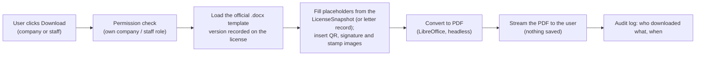

# Deliverable 6 — License, Permit and Letter Documents

- Project: SARIS Company Portal
- Version: 1.1 (approved 2026-10-28)
- Date: 2026-10-28
- Based on: the official templates in `docs/forms/templates/`, `docs/decisions-log.md`
  (D-006, D-011, D-012, D-013, D-019, D-027, D-028, D-068, D-069, D-106, D-107, D-109)

---

## 1. Documents Generated

| Document | Template file (official) | Number | Generated when |
|---|---|---|---|
| Importation License | `PCP_IMPORTATION_LICENSE.docx` | `PCPIL-YYYY-NNNN` | DG approval (D-106) |
| Wholesale License | `PCP_LICENSE_Wholesale_.docx` | `PCPWS-YYYY-NNNN` | DG approval |
| Retailer License | `PCP_LICENSE_Retailer.docx` | `PCPRT-YYYY-NNNN` | DG approval |
| Operator License | `PCP_OPERATOR_LICENSE.docx` | `PCA-YYYY-NNNN` | DG approval |
| Import Permit | `PCP_IMPORT_PERMIT-revised_18th_May_2026.docx` | `PCPIP-YYYY-NNNN` | DG approval |
| Permission-to-pay letter | New (procedure 6.10) | `PTP-YYYY-NNNN` | Payment Officer issues it (T17) |

Numbers come from `number_sequences` and reset each year (D-011, D-075). The template
placeholders `DATE YEAR 0000` / `DDYY0000` are replaced by this confirmed format.

---

## 2. How Documents Are Produced (D-138, D-145)

Documents are **not stored**. Each time someone opens or downloads a license, permit or
letter, the system fills the **official Word template** with the **saved data** and converts
it to PDF on the spot.

| Rule | Detail |
|---|---|
| Templates | The **official SARIS .docx files** from `docs/forms/templates/`, copied to `resources/templates/` with placeholders such as `${company_name}`, `${license_number}`, `${expiry_date}` put where the template shows `XXXX` or `00/00/0000`. Layout, letterhead (including the Arabic text), fonts and footer stay exactly as SARIS designed them |
| Filling | `phpoffice/phpword` TemplateProcessor: text placeholders from the snapshot; image placeholders (`${qr_code}`, `${signature}`, `${stamp}`) for the QR code, signer's signature and stamp; an optional block for "Valid from" (D-143) |
| Conversion | LibreOffice in headless mode on the server converts the filled .docx to PDF (D-109) |
| Source of data | **Only** the LicenseSnapshot (or the permission-to-pay letter record). Never live company data (D-006) |
| Same document every time | The license records the template version (`template_code`, e.g. `IMPORTATION_LICENSE_V1`) and the **signature and stamp image files used at approval** (in the snapshot). Old template versions are never deleted, so a license downloaded years later looks exactly as on the day it was issued (D-137) |
| Nothing stored | No PDF is saved in R2 or the database. Integrity rests on the snapshot hash (D-069) and the QR verification page (§5) |
| Speed | About 1–3 seconds per document. At most 2 conversions run at the same time (a lock); a third request waits briefly |
| Failure | If conversion fails, the user sees "Please try again in a moment" and the error is logged for the System Administrator. The license itself is unaffected |
| Dates | `DD/MM/YYYY` (D-144) |
| Fonts | The fonts used by the templates (and Noto Naskh Arabic for the Arabic text) are installed on the server so the conversion matches the original |
| Downloads | Every download is audit-logged (who, which document, when) |

## 3. Field Mapping

### 3.1 Licenses (Importation, Wholesale, Retailer, Operator)

All four share one layout; only the number prefix, title and type of business differ.

| Template field (Somali / English) | Value | Source |
|---|---|---|
| Shati Lam / License No | `PCPIL-2026-0001` etc. | `licenses.license_number` |
| Title | Per type, e.g. "SHATIGA SOO DEJINTA DULINDILAYAASHA / IMPORTATION LICENSE FOR PEST CONTROL PRODUCTS" | Template |
| Magaca Shirkadda / Name of the company | Company name | Snapshot `company.name` |
| Taariikhda la diiwan geliyey / Registered date | SARIS approval date | `licenses.registered_date` (D-013) |
| Nooca Ganacsi / Type of Business | Importation of Pest Control Products · Pest Control Products Wholesaler · Pest Control Product Retailer · PEST CONTROL SERVICE PROVIDER (Fumigation, Spraying etc.) | Template, by `document_type` |
| Cinwaanka Shirkadda / Company Address | Town or market, district, region, FMS (street and details if present) | Snapshot `company.address` |
| Jinsiyadda / Nationality | Owner/MD nationality (country name) | Snapshot `owner.nationality` (D-013) |
| Telefoonka / Cell phone no | Company phone | Snapshot `company.phone` |
| Caddeyn / Declaration | Official legal text, per type | Template (§6 corrections) |
| Shaabada Hay'adda / Stamp | SARIS stamp image | Settings (D-140) |
| Name & signature of authorized officer | Signer's **name**, signature image and title; if a delegate signs: "{name}, for the Director General" | `approved_by` user, `on_behalf_of` (D-027, D-139) |
| Taariikhda ay soo baxdey / Date of Issue | Approval date | `licenses.issued_at` |
| Ka shaqeynaya / Valid from | **Only when different from the issue date** (early renewal, D-107) | `licenses.valid_from` (D-143) |
| Taariikhda ay dhaceyso / Expiry Date | Expiry date | `licenses.expires_on` |
| Goobta laga soo saarey / Place of Issue | "Mogadishu - Somalia" | Settings |
| Note (financial liability) | Official text | Template |
| QR code + verification code | §5 | `verification_code` |
| Footer | SARIS telephone, email, address | Settings |

### 3.2 Import Permit

| Template field | Value | Source |
|---|---|---|
| No | `PCPIP-2026-0001` | `license_number` |
| Title and legal basis | "RUQSAD SOO DEJINTA DULINDILAYAASHA / PEST CONTROL PRODUCTS IMPORT PERMIT (Issued under Agrochemicals Control Law No. 33/2024)" and the permission paragraph | Template |
| Company Name, Address, Email, Telephone | Company details | Snapshot `company.*` |
| SARIS License No | The Importation License number at approval | Snapshot `importation_license.number` |
| Commercial Name | Trade name | Snapshot `product.trade_name` |
| Name of Active Ingredient (a.i.%) | Active ingredient and concentration | Snapshot `product.active_ingredient`, `concentration` |
| Formulation type | | Snapshot `product.formulation_type` |
| ~~Adjuvant~~ | **Removed** (D-019) | — |
| SARIS registration number of PCP | | Snapshot `product.saris_registration_no` |
| Permitted Quantity (L/Kg) | Quantity and unit | Snapshot `consignment.quantity`, `quantity_unit` |
| Number of pesticides arriving in this consignment | | Snapshot `consignment.total_products_in_consignment` |
| Manufacturing country / Origin | Country name | Snapshot `product.country_of_origin` |
| Registration No. in country of origin | | Snapshot `product.origin_registration_no` |
| Point of entry | | Snapshot `consignment.entry_port` |
| Means of entry | Sea / Air / Land | Snapshot `consignment.means_of_entry` |
| Purpose | Commercial / Sample | Snapshot `consignment.purpose` |
| Conditions (1) single consignment, (2) quantity limit | Official text | Template |
| Stamp, signer, Date of Issue, Expiry Date (+90 days), Place of Issue, Note, Footer | As §3.1 | As §3.1 |
| QR code + verification code | §5 | `verification_code` |

### 3.3 Permission-to-Pay Letter (procedure 6.10)

| Element | Value | Source |
|---|---|---|
| Letterhead and footer | As licenses | SARIS letter template (.docx) using the same letterhead |
| Letter number and date | `PTP-2026-0001`, issue date | `permission_to_pay_letters` |
| Applicant | Company name and address | Application's current snapshot |
| Reference and service | Application reference; service and category | `applications` |
| Fee | Amount in USD | Letter record (copied from fee schedule, D-038) |
| Payment instructions | "Pay at the SARIS office … then upload the receipt in the portal" | Settings (editable by the System Administrator) (D-146) |
| Issued by | Payment Officer's name and title | `issued_by` |
| QR | Not needed (not a public document) | — |

---

## 4. Signatures, Stamp and Settings (D-140)

| Item | Stored as | Managed by |
|---|---|---|
| Signature image of each signer (DG and each delegate) | `users.signature_file_id` → StoredFile (PNG, transparent, ≤ 1 MB) | System Administrator |
| Signer title (e.g. "Director General") | `users.title` | System Administrator |
| SARIS stamp image | Setting `documents.stamp_file_id` | System Administrator |
| Place of issue, footer contact lines, payment instructions | Settings | System Administrator |

- Settings live in a small `system_settings` table (key, value, updated_by), and every change is audit-logged.
- Signature and stamp images are used **only** when filling documents. They are never shown or downloadable in the portal, except to the System Administrator on the upload screen.
- A DG or delegate **cannot approve** until their signature image is uploaded; this is checked at T21.
- Only the image of the person who actually approved is printed (D-027).

---

## 5. QR Verification (D-012, D-141)

| Item | Rule |
|---|---|
| QR content | `{APP_URL}/verify/{verification_code}` |
| Verification code | 32 random characters (lowercase letters and digits), unique; not guessable |
| Printed under the QR | The short code and the URL, so it can be typed if the QR cannot be scanned |
| QR size and placement | About 30 × 30 mm, bottom right, above the footer; error correction level M |
| Page shows | License or permit number, company name, document type, status (Active, Expired, Superseded, Suspended, Cancelled), issue date, expiry date |
| Page never shows | Personal data, address, phone, documents, the PDF |
| Unknown code | "No document found" (same response for every invalid code) |
| Protection | 60 requests per minute per IP (03 §14) |

The page is public and requires no login. A status other than Active is shown clearly, in red.

---

## 6. Template Text Corrections (need SARIS approval, D-142)

The portal reproduces the official legal text exactly. These corrections, noted when the
forms were reviewed, are applied **only after SARIS approves the wording**:

| # | Template | Current text | Proposed |
|---|---|---|---|
| 1 | All four licenses | "Agrichmical Control Law No. 33/2024" | "Agrochemical Control Law No. 33/2024" |
| 2 | Wholesale and Retailer | Somali declaration says "ogolaanshahan **soo dejinta**" (import approval) | Wording for a sale license, to be provided by SARIS |
| 3 | Operator License | Check whether the same import wording appears | SARIS to confirm |
| 4 | Import Permit | "Somali Agricultural Regulatory and Inspection No. 32/2024" | "SARIS Law No. 32/2024" |
| 5 | All licenses | "Telefoonka lamb" | "Telefoonka lam." |
| 6 | Import Permit | Adjuvant row | Removed (already decided, D-019) |
| 7 | All | Director General's name printed in the template | Printed from the signer's record (§4) |

---

## 7. License Register (procedure 6.13)

The register is the `licenses` table, shown in the Admin Portal:

- **Filters:** document type, status, company, issue and expiry date ranges.
- **Columns:** number, company, type, status, issue date, expiry date, and the application reference.
- **Export to CSV** for staff who hold the view permission; every export is audit-logged (D-147).
- Each row opens the license, its PDF and its history.

---

## Open questions

1. SARIS to approve the text corrections in §6, and to provide the Somali wording for the
   Wholesale and Retailer declarations.
2. SARIS to provide: the DG's signature image (PNG) and the stamp image (PNG), plus the
   official .docx templates in their final approved form, and a letter template for the
   permission-to-pay letter on SARIS letterhead.

## Assumptions made

- [ASSUMPTION] One-page A4 portrait layout for every document, as in the official templates.

## Decisions (confirmed 2026-10-28)

| Decision | Summary |
|---|---|
| D-137 | Official templates are versioned; each license records its `template_code`, and the snapshot records the signature and stamp files used at approval, so every download is identical. |
| D-138 | Documents are produced by filling the **official SARIS .docx templates** (placeholders added) with the saved snapshot data, then converting to PDF. |
| D-139 | Field mapping in §3; the signer's own name and title are printed, with "for the Director General" when a delegate signs. |
| D-140 | Signature image per signer, stamp and document settings managed by the System Administrator in a `system_settings` table; approval blocked until the signer's signature exists. |
| D-141 | QR verification code and public page as in §5. |
| D-142 | Template text corrections in §6 applied only after SARIS approval. |
| D-143 | A "Valid from" line is printed only when it differs from the issue date (early renewal). |
| D-144 | Dates printed as DD/MM/YYYY; place of issue from settings. |
| D-145 | PDFs are **not stored**: they are generated on demand from the saved data each time a document is opened or downloaded; every download is audit-logged. |
| D-146 | Permission-to-pay letter content as in §3.3, with payment instructions from settings. |
| D-147 | License register screen with filters and audited CSV export. |
