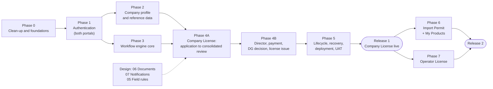

# Deliverable 9 — Phased Implementation Plan

- Project: SARIS Company Portal
- Version: 1.2 (approved 2026-10-28; documents on demand)
- Date: 2026-10-28
- Based on: `docs/decisions-log.md` (D-001 to D-118), Deliverables 01, 02, 03, 04, 08,
  `docs/design/00-current-state.md`

---

## 1. Strategy

1. **Company License first** (H8, D-035). It is the prerequisite for the Import Permit (D-015)
   and exercises every part of the system: profile, workflow, inspection, payment, license.
2. **Foundations before features.** Clean-up, authentication and the workflow engine are built
   once and reused by every service.
3. **Small, testable phases.** Each phase ends with working, tested code on `main` and a
   checklist that SARIS can verify.
4. **Design stays ahead of code.** Deliverables 06 (documents) and 07 (notifications) are
   designed here while Phases 0–3 are built, so they are ready before Phase 4.

### Releases

| Release | Contents | Goes live after |
|---|---|---|
| **Release 1 (MVP)** | Accounts, company profile, Company License (all 3 categories) end to end, license lifecycle, public verification | Phase 5 + SARIS acceptance |
| **Release 2** | Import Permit (with My Products) and Operator License | Phases 6–7 + SARIS acceptance |
| **Later** | Backlog in §6 | Planned separately |



---

## 2. How Each Phase Is Run

1. **Branch:** one branch per phase, e.g. `feature/phase-1-auth`. Larger phases use one pull request per sub-feature (D-115).
2. **Start:** Claude Code reads CLAUDE.md, the decisions log and the design documents listed for the phase.
3. **Build:** code plus the tests listed for the phase. `composer run check` must pass (D-114).
4. **New decisions:** any implementation decision not covered by the design is added to the decisions log as **Proposed**, and Claude Code tells you.
5. **Close:** every "Done when" item is ticked. You bring the Proposed decisions back to this design Project for confirmation, then merge to `main`.
6. **Demo:** for Phases 4–7, the phase is shown to SARIS staff on staging before the next phase starts.

---

## 3. Phases

Effort estimates assume one developer working with Claude Code [ASSUMPTION]; they include
tests but not waiting time for SARIS inputs.

### Phase 0 — Clean-up and Foundations (about 1 week)

**Goal:** bring the existing codebase in line with the confirmed design before adding features.

| Item | Decisions |
|---|---|
| Move `saris-portal/docs/` to `docs/`, merge CLAUDE.md files (if not already done); fill CLAUDE.md tech stack and conventions from 08 §9 | D-060, 08 |
| Remove Passport and Jetstream (packages, routes, tables, traits, config) | D-049 |
| MySQL 8 everywhere; test database `saris_portal_testing`; update `.env.example` (08 §2); remove `.rnd` | D-050, 08 |
| Replace Super Admin and `Gate::before` with System Administrator; seed the D-023 roles and their permissions | D-051, D-023, D-106 |
| Staff `status` enum; deactivate instead of delete; soft deletes; remove self-delete; `first_login = true` on creation | D-053 |
| Strong password policy everywhere, including staff forms | D-082 |
| `app/Domain/<Module>` structure; controllers split into Admin, Portal, Public | D-061 |
| Audit log package with masked attributes; MySQL triggers blocking UPDATE/DELETE on audit rows | D-055, D-091 |
| `lang/en.json`, `lang/so.json`, `t()` helper shared through Inertia; missing-key test | D-054, D-116 |
| Security headers and nonce CSP | D-090 |
| R2 disks (`r2`, `r2_backups`), StoredFile model and Documents module storage service | D-056 |
| NumberSequence with locked increment | D-011, D-075 |
| `composer run check` script; GitHub Actions workflow (kept even if Actions is unavailable) | D-114 |
| Add packages from 08 §1.3 | D-108 |

**Done when:**
- [ ] Passport and Jetstream are gone, and `php artisan route:list` shows no Jetstream or OAuth routes.
- [ ] Only the System Administrator and the D-023 roles exist; nobody bypasses permissions.
- [ ] Deleting a staff user is impossible; deactivation logs the user out.
- [ ] An audit row cannot be updated or deleted (test).
- [ ] A file can be stored to and read from R2 through the Documents module (test with a fake disk).
- [ ] `composer run check` passes.

**Claude Code prompt:**

```
Phase 0 — Clean-up and foundations.
Read CLAUDE.md, docs/decisions-log.md, docs/design/00-current-state.md,
01-architecture.md §6, 03-auth-security.md, 08-tech-stack.md and
09-implementation-plan.md (Phase 0). Implement every item in the Phase 0 table, in
small commits on branch feature/phase-0-foundations. Do not build any SARIS feature
yet. Write the tests needed to prove each "Done when" item. Run composer run check.
List anything not covered by the design as Proposed entries in the decisions log
and tell me. Finish with a summary of what changed and the open questions.
```

### Phase 1 — Authentication for Both Portals (about 2 weeks)

**Goal:** staff and companies can sign in to their own portal only, safely.

| Item | Decisions |
|---|---|
| `company_users` table and model, `company` guard, `company_users` password broker | D-048 |
| Route files `admin.php`, `portal.php`, `public.php`; `/admin/*` and `/portal/*` prefixes; layouts | D-048 |
| `SetAuthArea` middleware (before StartSession); Fortify routes registered per area; separate session cookies | D-062, D-079 |
| Company sign-up with temporary password (1 hour), "send a new temporary password", honeypot, identical responses | D-063, D-080 |
| ForcePasswordChange for both realms; password history (last 5) and 90-day expiry with reminders | D-082 |
| Lockout after 5 failures for 15 minutes, with email | D-081 |
| Mandatory staff 2FA; optional company 2FA; staff 2FA reset by System Administrator | D-052, D-064, D-087 |
| Staff creation with emailed temporary password (24 hours) | D-083 |
| Session timeouts (15/30 minutes), staff 12-hour limit, password confirmation windows | D-084, D-085 |
| Company login-email change | D-093 |
| Auth emails in English and Somali (temporary password, lockout, reset, email change), sent through Resend | D-118 |

**Done when:**
- [ ] All authentication tests in 03-auth-security §15 (items 1, 2, 6, 7, 8, 9) pass.
- [ ] A new company can sign up, log in with the temporary password, set a password and reach an empty company dashboard.
- [ ] A new staff member receives a temporary password, sets a password, enrols 2FA and reaches the admin dashboard.
- [ ] Logging in to one portal does not affect the other in the same browser.

**Claude Code prompt:**

```
Phase 1 — Authentication for both portals.
Read CLAUDE.md, docs/decisions-log.md, 01-architecture.md §4, 02-data-model.md §4.1,
03-auth-security.md (all) and 09-implementation-plan.md (Phase 1). Implement the
Phase 1 table on branch feature/phase-1-auth, one pull request per row group.
Use Fortify for both portals exactly as described in 03 §3 — no custom login system.
Implement the tests in 03 §15 items 1, 2, 6, 7, 8 and 9. Run composer run check.
Add Proposed decisions for anything not covered, and report open questions.
```

### Phase 2 — Company Profile and Reference Data (about 1.5 weeks)

**Goal:** a company can build its complete profile once (single source of truth).

| Item | Decisions |
|---|---|
| Reference data: FMS and regions (seeded from the SARIS list), admin screens for lists | D-065 |
| Company profile with structured address; normalisation on save | D-065, D-076 |
| Persons: encrypted national ID + HMAC hash, system-wide unique, privacy-safe duplicate message | D-066, D-088, D-117 |
| Premises with facility checklist; mandatory photos; phone-side compression; server re-encoding | D-018, D-089 |
| Documents with types, numbers, dates, expiry and replacement history; renewed certificate upload at any time with staff notice | D-017, D-067, D-073 |
| Edit-lock policy (editable before first submission; locked rules ready for Phase 4) | D-073 |
| Admin: read-only company directory and company file; national-ID release by System Administrator | D-095 |

**Done when:**
- [ ] A company can complete its profile, persons, premises (with photos) and documents on a phone over a slow connection.
- [ ] A duplicate national ID is blocked without naming the other company; after a release it works, and the old company is flagged.
- [ ] A company cannot see or change another company's data (03 §15 item 3).
- [ ] Uploads reject renamed executables, oversized files and PDFs with JavaScript (03 §15 item 10).

**Claude Code prompt:**

```
Phase 2 — Company profile and reference data.
Read CLAUDE.md, docs/decisions-log.md, 02-data-model.md (§4.2–4.4, §6),
03-auth-security.md §11.3 and §12, and 09-implementation-plan.md (Phase 2).
Implement the Phase 2 table on branch feature/phase-2-profile. All file handling goes
through the Documents module. Mobile-first pages, all text via t(). Implement tests
for 03 §15 items 3 and 10 and for the duplicate national-ID rules. Run composer run
check. Add Proposed decisions for anything not covered.
```

### Phase 3 — Workflow Engine Core (about 1.5 weeks; can run in parallel with Phase 2)

**Goal:** the generic engine works and the Company License definition loads.

| Item | Decisions |
|---|---|
| Tables: workflow_templates, workflow_stages, workflow_transitions, workflow_actions, review_items, stage_assignments | D-071 |
| `config/workflows/company_license_v1.php` and `php artisan workflows:load` with definition validation | D-097 |
| `WorkflowEngine::perform()` with row lock, `expected_status`, ordered checks, one transaction, after-commit queue | D-096 |
| `availableActions()`; guard and effect base classes; delegation and segregation checks | D-027, D-086 |
| Applications and ApplicationVersion tables; snapshot builder with hash | D-042, D-069, D-070 |

**Done when:**
- [ ] 04-workflow-engine §16 items 2, 4, 5 and 10 pass using a test definition.
- [ ] The Company License definition loads without errors.
- [ ] A snapshot is identical when rebuilt, and its hash verifies.

**Claude Code prompt:**

```
Phase 3 — Workflow engine core.
Read CLAUDE.md, docs/decisions-log.md, 02-data-model.md §4.6–4.7 and §6.3,
04-workflow-engine.md (all) and 09-implementation-plan.md (Phase 3). Build the generic
engine on branch feature/phase-3-workflow. Do not build service-specific screens yet.
Write config/workflows/company_license_v1.php from 04 §5. Implement 04 §16 items 2,
4, 5 and 10 with a small test definition. Run composer run check. Add Proposed
decisions for anything not covered.
```

### Phase 4A — Company License: Application to Consolidated Review (about 2.5 weeks)

**Prerequisites:** Deliverable 07 (notifications) and the short field-rules document (05) approved.

| Item | Decisions |
|---|---|
| Company: new application (category), select premises and technical person, declaration with password confirmation, submit, see status, respond to returns, resubmit | D-014, D-042, D-043, D-073, T1, T25 |
| Edit lock active (Draft/Returned only) | D-073 |
| Admin: work queues (My work, by stage, waiting on company, flags) | D-105 |
| Admin: application file (snapshot, versions with differences, history timeline) | D-042 |
| Registrar: acknowledge, admin review, technical review, review checklists, returns, Technical Reviewer assignment | D-102, T2–T8 |
| Inspection: scheduling, rescheduling, mobile inspection form (checklist incl. SOPs, photos, GPS), visit, signed report | D-077, D-099, T9–T11 |
| Consolidated review and re-inspection | T12–T14 |
| Emails for these events (Deliverable 07) | — |

**Done when:**
- [ ] A Company License application can go from Draft to consolidated review, including a return and resubmission, with the correct emails.
- [ ] An Inspector can complete and sign a report on a phone at the premises.
- [ ] Every transition T1–T14 and T25 has allowed and refused tests.

**Claude Code prompt:**

```
Phase 4A — Company License, application to consolidated review.
Read CLAUDE.md, docs/decisions-log.md, 02-data-model.md, 04-workflow-engine.md §5,
§9, §10, §15, 05 (field rules), 07 (notifications) and 09-implementation-plan.md
(Phase 4A). Implement the Phase 4A table on branch feature/phase-4a-license-review,
one pull request per row. All status changes through WorkflowEngine::perform().
Tests for every transition T1–T14 and T25, allowed and refused. Run composer run
check. Add Proposed decisions for anything not covered.
```

### Phase 4B — Director, Payment, DG Decision and License Issue (about 2 weeks)

**Prerequisites:** Deliverable 06 (documents) approved; SARIS fee schedule received (F1).

| Item | Decisions |
|---|---|
| Director recommendation and return to Registrar | T15–T16 |
| Fee schedule admin (System Administrator) | D-038, D-078 |
| Permission-to-pay letter (fee locked from schedule; PDF on demand from the SARIS letter template) | D-028, D-038, D-109, D-145, T17 |
| Receipt upload, clearance and rejection; one receipt per payment | D-074, T18–T20 |
| DG decision: approve, defer, reject; delegation; segregation; password confirmation | D-024, D-027, D-086, T21–T23 |
| Automatic license issue: number, LicenseSnapshot (with signature and stamp files), QR code, `ACTIVE`, register; official .docx templates with placeholders; PDF generated on demand with PhpWord + LibreOffice; signature, stamp and settings screens | D-106, D-011, D-068, D-137–D-147 |
| Public verification page `/verify/{code}` | D-012 |
| Deferral shortcut (consolidated review → DG, payment kept) | D-043, T12 |

**Done when:**
- [ ] A full Company License runs from Draft to Issued, and the PDF matches the official template for each category.
- [ ] Scanning the QR code opens the verification page with only the allowed fields.
- [ ] Segregation rules, delegation dates and fee locking are proven by tests.
- [ ] 04 §16 items 1, 3 and 6 pass for the Company License.

**Claude Code prompt:**

```
Phase 4B — Director, payment, DG decision and license issue.
Read CLAUDE.md, docs/decisions-log.md, 02-data-model.md §4.10–4.11, 04-workflow-engine.md
§5 and §10–12, 06 (documents) and 09-implementation-plan.md (Phase 4B). Implement the
Phase 4B table on branch feature/phase-4b-payment-issue. Fees only from the fee
schedule; license issue in the same transaction as DG approval; PDFs generated on
demand from the official .docx templates (06-documents §2), never stored.
Tests for T12 (deferral path), T15–T23, segregation, delegation and verification
page fields. Run composer run check. Add Proposed decisions for anything not covered.
```

### Phase 5 — Lifecycle, Recovery, Deployment and Acceptance (about 2.5 weeks)

| Item | Decisions |
|---|---|
| Scheduled jobs: license expiry, renewal reminders (60/30 days), certificate reminders (30 days), password-expiry reminders, token cleanup | D-009, D-017, D-058, D-082 |
| Renewal (window, late flag, start date) and amendment (full fee, supersede, clear flag) | D-103, D-107, D-008 |
| Enforcement actions: request, DG approval, suspend, reinstate, cancel | D-010, D-104 |
| Account recovery (public form, System Administrator review, effects) | D-003, D-092, D-095 |
| Backups (nightly, encrypted, R2) with a tested restore | D-059 |
| Server set-up: PHP 8.3, MySQL 8, Nginx with Let's Encrypt, fail2ban, ufw and Cloud Firewall, Supervisor (queue and SSR), cron, LibreOffice and template fonts | D-094, D-110, D-112, D-109 |
| Deployment script with rollback (§4); staging environment | D-057, D-122 |
| Resend domain verification for noreply@saris.gov.so | D-118 |
| Seed real data: fee schedule, FMS/regions, roles and staff accounts | — |
| Somali translation review by SARIS | D-116 |
| User acceptance testing with SARIS staff on staging (§5) | D-123 |

**Done when:**
- [ ] Renewal and amendment work end to end, and the old license is superseded.
- [ ] A backup has been restored successfully on staging.
- [ ] The go-live checklist (§5) is complete and SARIS has signed off.

**Claude Code prompt:**

```
Phase 5 — Lifecycle, recovery and deployment.
Read CLAUDE.md, docs/decisions-log.md, 03-auth-security.md §10 and §12.4,
04-workflow-engine.md §8 and §14, 08-tech-stack.md and 09-implementation-plan.md
(Phase 5 and §4). Implement the application items of the Phase 5 table on branch
feature/phase-5-lifecycle, and write deploy/deploy.sh, deploy/nginx.conf.example,
deploy/supervisor.conf.example and a server set-up guide in docs/ops/. Tests for
renewal, amendment, enforcement and recovery. Run composer run check. Add Proposed
decisions for anything not covered.
```

**→ Release 1: Company License live** (cutover date set by SARIS, A11).

### Phase 6 — Import Permit and My Products (about 2.5 weeks)

**Prerequisites:** the SARIS Import Permit procedure if available (otherwise the interim
definition, D-100); the restricted and banned ingredient list.

| Item | Decisions |
|---|---|
| My Products with documents; staff verification; banned/restricted check on save | D-039, D-021 |
| Restricted ingredient list admin | D-021 |
| Import Permit application (one product, consignment details, storage premises); duplicate-product warning; no limit on open permits | D-019, D-072 |
| `config/workflows/import_permit_v1.php`; Importation License check at submit and at DG approval | D-015, D-100 |
| Permit PDF (PCPIP), 90-day validity and expiry; flagging when the Importation License is suspended or cancelled | D-021, D-010 |

**Claude Code prompt:**

```
Phase 6 — Import Permit and My Products.
Read CLAUDE.md, docs/decisions-log.md, 02-data-model.md §4.5–4.6, 04-workflow-engine.md
§7, 06 and 07, and 09-implementation-plan.md (Phase 6). Implement on branch
feature/phase-6-import-permit. Write config/workflows/import_permit_v1.php. Tests
for every Import Permit guard (04 §11) and 04 §16 item 7. Run composer run check.
Add Proposed decisions for anything not covered.
```

### Phase 7 — Operator License (about 1 week)

**Prerequisites:** the SARIS Operator License procedure if available (otherwise D-100).

| Item | Decisions |
|---|---|
| `config/workflows/operator_license_v1.php` (Form 2 checklist, equipment inventory, fumigation inspection items) | D-100 |
| Operator License PDF (PCA) | D-011 |

**→ Release 2: Import Permit and Operator License live** after SARIS acceptance on staging.

---

## 4. Deployment Process (D-122)

`deploy/deploy.sh` on the server, run from `main` only:

1. Back up the database to R2 (`backup:run --only-db`).
2. Clone the release into `releases/<timestamp>/`, and link the shared `.env` and `storage/`.
3. `composer install --no-dev --optimize-autoloader`
4. `npm ci && npm run build && npm run build:ssr`
5. `php artisan migrate --force`, then `php artisan workflows:load`
6. `php artisan optimize` (caches config, routes, views and events)
7. Switch the `current` symlink to the new release; reload PHP-FPM.
8. `php artisan queue:restart`; restart the SSR process in Supervisor.
9. Check `/up`. If it fails, switch the symlink back to the previous release, the **rollback**.

The last 5 releases are kept. Every database change must be backward-compatible for one release, so a rollback never needs a database restore.

---

## 5. Acceptance and Go-Live

### User acceptance testing (UAT) on staging

| Who (SARIS) | Tests |
|---|---|
| Pesticide Registrar | Acknowledge, review checklists, returns, assignment, scheduling, consolidated review, recovery |
| Inspector | Mobile inspection at a real premises: checklist, photos, GPS, signing |
| Departmental Director | Recommend and return |
| Payment Officer | Letter, receipt verification, rejection |
| DG and a delegate | Approve, defer, reject; check the license PDF |
| System Administrator | Staff accounts, roles, 2FA reset, reference data, fees, ID release |
| 2–3 volunteer companies | Sign-up to license on their own phones |

### Go-live checklist (Release 1)

- [ ] All Phase 0–5 "Done when" items are ticked.
- [ ] The fee schedule, FMS/region list and Somali translations are approved by SARIS.
- [ ] Staff accounts are created, and every staff member has enrolled 2FA.
- [ ] The license PDFs are checked against the official templates for all three categories, and repeated downloads produce identical documents.
- [ ] Resend domain verified; test emails arrive in the inbox, not spam.
- [ ] HTTPS certificate valid; firewall rules in place; fail2ban active.
- [ ] Nightly backup running, and a restore tested.
- [ ] Written procedure 6.13 updated by SARIS (D-106).
- [ ] Cutover date announced to companies (A11).
- [ ] Acceptance signed off by the SARIS IT Advisor (D-123).

---

## 6. Backlog (After Release 2)

| Item | Source |
|---|---|
| Antivirus scanning of uploads | D-089 |
| Edge protection (Cloudflare proxy or similar) if attacks occur | D-094 |
| Closing abandoned applications | Open question 14 |
| Revocation, non-renewal and blacklisting | Open question 6 |
| Reports and dashboards for management | — |
| SMS notifications | G4 |
| Online payment (mobile money or bank) | F3 |
| NIRA identity verification | G3 |
| Product registration as an online service | B15 |
| Configurable license lifecycle | D-104 |

---

## 7. Remaining Design Work

| Deliverable | Content | Needed before |
|---|---|---|
| 05 — Field rules | Per-field validation for Forms 1–3 (required, format, length). Most of the original "application lifecycle" scope is already in 02 and 04 | Phase 4A |
| 06 — Documents | Certificate and permit templates, permission-to-pay letter, numbering, QR code, signature and stamp images, PDF layout | Phase 4B |
| 07 — Notifications | Every email: event, recipient, language, content | Phase 4A (auth emails are already defined in 03 for Phase 1) |

---

## 8. Inputs Needed from SARIS

| Input | Needed before |
|---|---|
| Official FMS and region list | End of Phase 2 |
| Fee schedule (USD) per service, category and type (F1) | Phase 4B |
| DG signature image, SARIS stamp image, final official .docx templates and a letter template for the permission-to-pay letter | Phase 4B |
| Droplet details: OS, PHP version, other sites (open question 8) | Phase 5 |
| Staff names, emails and roles for accounts | Phase 5 |
| Reviewer for the Somali translations | Phase 5 |
| UAT participants and volunteer companies | Phase 5 |
| Restricted and banned active ingredient list | Phase 6 |
| Import Permit and Operator License written procedures | Phases 6 and 7 |
| Target go-live date | To plan Phase 5 |

---

## Open questions

1. No fixed go-live date yet. The estimates in §3 add up to roughly 13–15 weeks of
   development for Release 1, plus UAT time [ASSUMPTION]; the date is set when Phase 5
   is near.

## Assumptions made

- [ASSUMPTION] One developer working with Claude Code; estimates exclude waiting time for SARIS inputs.
- [ASSUMPTION] Staging runs on the same droplet under a staging subdomain (open question 10 in the log).

## Decisions (confirmed 2026-10-28)

| Decision | Summary |
|---|---|
| D-119 | Phases 0–7; Release 1 = Company License; Release 2 = Import Permit and Operator License. |
| D-120 | Deliverable 05 reduced to field validation rules; 05, 06 and 07 designed during Phases 0–3; 05 and 07 before Phase 4A, 06 before Phase 4B. |
| D-121 | Phase process in §2: branch per phase, pull request per sub-feature, checks and checklist, Proposed decisions confirmed before merge. |
| D-122 | Deployment with release folders, `current` symlink, database backup first and one-step rollback (§4). |
| D-123 | UAT on staging with SARIS staff and volunteer companies; the SARIS IT Advisor signs off each release. |
| D-124 | Backlog in §6 is out of scope for Releases 1 and 2. |
